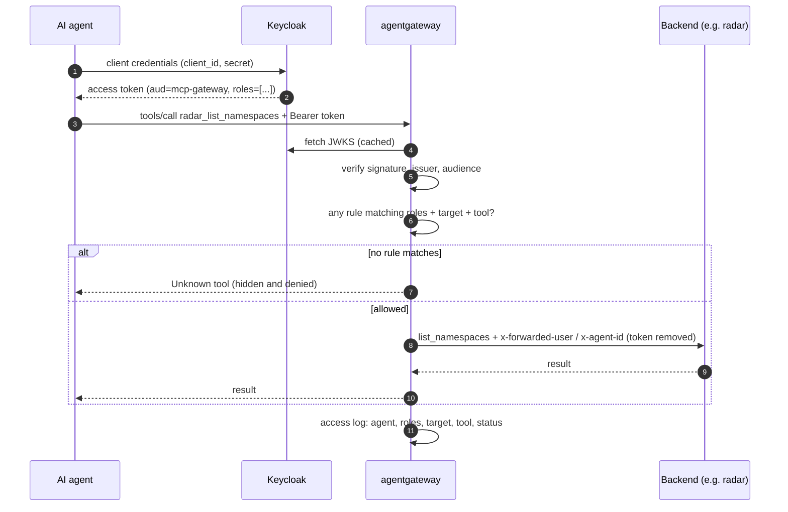

<div align="center">

# MCP Gateway RBAC

**One authenticated, role-filtered MCP endpoint for every AI agent and every tool.**

[](https://agentgateway.dev)
[](https://www.keycloak.org)
[](https://kind.sigs.k8s.io)
[](https://modelcontextprotocol.io)
[](observability/grafana/)

</div>

AI agents are getting direct access to production tools such as Kubernetes, Airflow, dbt, OpenMetadata and Spark. Without a single control point, each MCP server ends up with its own authentication, nobody can say which agent called what, and a compromised pod can call any backend directly.

This project puts **[agentgateway](https://agentgateway.dev)** in front of five MCP servers on a local Kubernetes cluster and builds the full trust chain **from configuration only, with no custom gateway code**:

| | |
|---|---|
| 🔐 **Authenticate** | Every call carries a Keycloak JWT; invalid tokens get `401` |
| 🧰 **Authorize per tool** | Each agent *sees* and *calls* only the tools its roles allow (deny by default) |
| 🪪 **Forward identity** | Backends learn who called; the caller's token never leaves the gateway |
| 🧱 **Isolate the network** | NetworkPolicy makes the gateway the only way into the backends |
| 📊 **Audit** | Every allow and deny is logged and charted in Grafana |

## Tech stack

<table align="center">
  <tr>
    <th>Gateway &amp; protocol</th>
    <th>Identity</th>
    <th>Platform</th>
    <th>Observability</th>
    <th>MCP backends</th>
    <th>Tooling</th>
  </tr>
  <tr>
    <td align="center">
      <a href="https://agentgateway.dev"></a><br><sub>agentgateway</sub><br><br>
      <a href="https://modelcontextprotocol.io"></a><br><sub>MCP</sub>
    </td>
    <td align="center">
      <a href="https://www.keycloak.org"></a><br><sub>Keycloak</sub><br><br>
      <br><sub>JWT / OAuth 2.0</sub>
    </td>
    <td align="center">
      <a href="https://kind.sigs.k8s.io"></a><br><sub>Kubernetes (kind)</sub><br><br>
      <br><sub>Docker</sub><br><br>
      <br><sub>Helm</sub>
    </td>
    <td align="center">
      <br><sub>Grafana · Loki · Alloy</sub><br><br>
      <br><sub>Metrics</sub>
    </td>
    <td align="center">
      <br><sub>Airflow</sub><br><br>
      <br><sub>Spark History</sub><br><br>
      <br><sub>OpenMetadata</sub>
    </td>
    <td align="center">
      <br><sub>Python (FastMCP)</sub><br><br>
      <br><sub>Bash</sub><br><br>
      <br><sub>PowerShell</sub>
    </td>
  </tr>
</table>

---

## Architecture

<p align="center">
  
</p>

Every tool call passes five checks in the gateway's data plane:

| # | Check | Question it answers | Configured in |
|:-:|---|---|---|
| 01 | **Check token** | Is the JWT genuine, unexpired and issued for `mcp-gateway`? | [`deploy/auth/`](deploy/auth/) |
| 02 | **Filter tools** | May these roles see and call this `{target}_{tool}`? | [`rbac/tool-access.yaml`](rbac/tool-access.yaml) |
| 03 | **Pass identity** | What does the backend learn? Headers set from verified claims; token dropped | [`deploy/auth/`](deploy/auth/) |
| 04 | **Swap token** | OpenMetadata gets an exchanged, audience-scoped token *(designed)* | [`deploy/identity/`](deploy/identity/) |
| 05 | **Log** | Who called which tool, and was it allowed? | [`observability/access-logs/`](observability/access-logs/) |

Network isolation sits underneath all five: [`deploy/network/`](deploy/network/) only lets the gateway namespace reach `mcp`.

<details>
<summary><b>Request sequence for a single tool call</b></summary>



</details>

### Docker map

Everything runs on one Docker host: the kind node holds the gateway, Keycloak, mocks, radar and the observability stack; OpenMetadata and Spark History run as separate Compose projects on the same `kind` network.

<p align="center">
  
  <br><sub>Containers, exposed ports and volumes. Solid arrows: published ports; dashed arrows: traffic and storage.</sub>
</p>

---

## Tool catalog

One endpoint (`/mcp`) multiplexes five targets. Tools reach clients as `{target}_{tool}`, e.g. `radar_list_namespaces`.

| Target | Tools | Read | Write / Execute | Backend |
|---|:-:|:-:|:-:|---|
| `radar` | 4 | 3 | 1 | real (Helm) or mock |
| `spark-history` | 3 | 3 | – | real (Docker) or mock |
| `openmetadata` | 4 | 3 | 1 | real (Docker) or mock |
| `dbt` | 5 | 4 | 1 | mock |
| `airflow` | 5 | 3 | 2 | mock |
| **Total** | **21** | | | |

Mock write tools are write-*shaped* but have no side effects.

## AI agent identities

Each agent is its own confidential Keycloak client (OAuth client credentials). Roles are split by **capability per system** (viewer vs. operator/editor), not by job title, so an agent only gets what it needs.

| Agent | Roles | Tools |
|---|---|:-:|
| `cluster-observer-agent` | `kube_viewer` | 3 |
| `incident-response-agent` | `kube_operator`, `spark_viewer` | 7 |
| `spark-diagnostic-agent` | `spark_viewer` | 3 |
| `metadata-discovery-agent` | `metadata_viewer` | 3 |
| `metadata-steward-agent` | `metadata_editor` | 4 |
| `dbt-quality-agent` | `dbt_operator` | 5 |
| `airflow-monitor-agent` | `airflow_viewer` | 3 |
| `airflow-operator-agent` | `airflow_operator` | 5 |
| `platform-admin-agent` | `platform_admin` | 21 |
| `no-access-agent` | *(none)* | 0 |

The machine-readable contract is [`tests/expected/agent-tool-access.json`](tests/expected/agent-tool-access.json). Rules are OR-ed: an agent with several roles gets the union.

---

## Results

All numbers come from saved test output in [`evidence/`](evidence/).

| Check | Expected | Measured |
|---|:-:|:-:|
| Tools callable through `/mcp` with correct prefix | 21 | **21** |
| Agent × tool cells matching the contract in `tools/list` | 210 | **210** |
| Agents with the correct `roles` claim | 10 | **10** |
| Out-of-scope calls blocked | 9 | **9** |
| Calls with an audit record | 18 | **18** |
| Pod in `default` reaching a backend | blocked | **timeout** |
| *Warm start*: apply all layers (mean of 5) | – | **4.15 s** |
| *Warm start*: ready for agents (mean of 5) | – | **≈ 5.2 s** |

<p align="center">
  
  <br><sub>Grafana allow/deny dashboard after one RBAC test run: 9 allowed, 9 denied, broken down by agent, role, target and tool.</sub>
</p>

---

## Quick start

**Requirements:** `kind`, `kubectl`, `helm`, Docker with Compose (~8 GB memory), Node 22.19+, `curl`, `jq`; Python with `mcp==1.30.0` for the Python tests.

```bash
./bootstrap.sh     # once: kind cluster, Gateway API CRDs + agentgateway, mock image
./run.sh           # every time: apply all layers;  ./run.sh test  also runs the tests
```

On Windows, run the same steps through WSL with PowerShell:

```powershell
.\ops\up.ps1       # start everything
.\ops\down.ps1     # delete the cluster
```

Both paths are idempotent. The first run downloads about 4 GB. See **[QUICKSTART.md](QUICKSTART.md)** for the manual steps, checks, cleanup and troubleshooting.

| Service | Address |
|---|---|
| MCP endpoint | `http://localhost:8080/mcp` (with `Authorization: Bearer <token>`) |
| Keycloak | `http://localhost:8002` (`admin` / `admin`) |
| Grafana | `http://localhost:3000` (`admin` / `admin`) |
| OpenMetadata | `http://localhost:8585` |
| agentgateway admin UI (read-only) | `http://localhost:15000/ui/` |

> [!WARNING]
> The default credentials above and the test-user password `password` are for local use only. Change them before running anywhere else.

### Try it

```bash
TOKEN=$(scripts/get-token.sh engineer.user)
npx -y @modelcontextprotocol/inspector@0.21.2 --cli "http://localhost:8080/mcp" \
  --transport http --header "Authorization: Bearer $TOKEN" --method tools/list
```

Always call the gateway, never a backend directly.

### Tests

```bash
node tests/static_contract_test.mjs   # manifests vs. contract, no cluster needed
python servers/smoke_test.py          # mocks locally, identity headers
python tests/gateway_smoke.py         # all 21 tools through localhost:8080
python tests/agent_rbac_smoke.py      # 10 agents: claims, visible tools, allowed/denied calls
bash scripts/run-tests.sh             # everything against the running cluster
```

---

## Repository layout

```
deploy/
  agentgateway/      Gateway, HTTPRoute, AgentgatewayBackend (5 targets)
  auth/              JWT validation + identity headers
  identity/          token exchange (OpenMetadata)
  keycloak/          Keycloak, realm and agent setup scripts
  network/           NetworkPolicy: backends accept only the gateway
  real-servers/      real radar (Helm), OpenMetadata and Spark History (Docker)
  cluster/           kind config and CNI notes
rbac/                tool-access.yaml: the role → tool policy (source of truth)
servers/             FastMCP mocks, one folder per target; k8s/mocks.yaml deploys them
observability/       access-log fields, Loki/Alloy/Grafana dashboard
tests/               contract, smoke and RBAC tests; expected/ holds the matrices
scripts/  ops/       Linux (bash) and Windows (PowerShell) automation
evidence/            saved outputs behind every reported number
docs/                design notes, observability review, diagrams/
report/              internship report (LaTeX)
```

### Common changes

| I want to… | Change |
|---|---|
| Give a role more tools | `rbac/tool-access.yaml` **and** `tests/expected/` in the same commit |
| Add an agent | New Keycloak client + roles, then add it to `tests/expected/agent-tool-access.json` |
| Swap a mock for a real server | `host`/`port` of the target in `deploy/agentgateway/AgentgatewayBackend.yaml`; name and rules stay |
| Add or rename a tool | `servers/<target>/server.py`, backend, RBAC, expected matrix, `CASES` in `tests/gateway_smoke.py`, and the 21-tool count |

Keep a target's name identical across its mock folder, Service, backend target, RBAC rules and tests.

---

## Scope and limitations

This is a proof of concept on a local kind cluster, not a production deployment.

- Token exchange for OpenMetadata and per-resource authorization on real backends are **designed but not complete**.
- Agents acting **on behalf of a human user** (delegated identity) is out of scope.
- Only *warm start* was measured; *cold start* and gateway latency under load were not.

## Documentation

| Document | Content |
|---|---|
| [QUICKSTART.md](QUICKSTART.md) | Setup, checks, cleanup, troubleshooting |
| [docs/ai-agent-tool-access.md](docs/ai-agent-tool-access.md) | Agent identities, capability roles, 21-tool matrix |
| [rbac/policy-overlap-experiment.md](rbac/policy-overlap-experiment.md) | Why everything is one `Allow` policy |
| [docs/agentgateway-observability-review.md](docs/agentgateway-observability-review.md) | Logs, metrics, traces and denials on agentgateway v1.5.0 |
| [deploy/real-servers/README.md](deploy/real-servers/README.md) | Real radar, OpenMetadata and Spark History, and their limits |
| [docs/diagrams/](docs/diagrams/) | Editable draw.io diagrams and the numbered system flow |

## Authors

Internship project at VietCredit, Faculty of Information Systems, University of Economics and Law (VNU-HCM), 2026.

- **Vòng Hữu Quân**: mock MCP servers, Keycloak realm, JWT and RBAC rules, Linux automation, documentation
- **Nguyễn Trần Thái Huy**: AI agent identities, NetworkPolicy, observability and Grafana, Windows automation, testing and evaluation

Supervisor: Assoc. Prof. Dr. Lê Hoành Sử.
