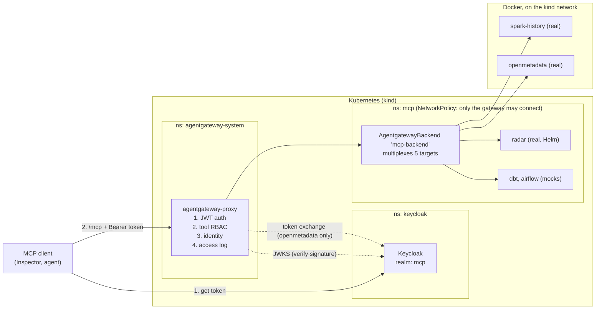
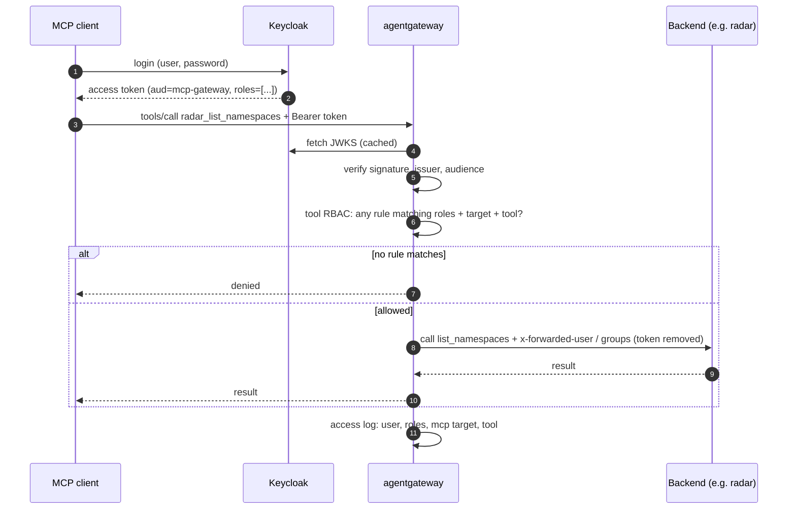

# MCP Gateway RBAC

Deploys [agentgateway](https://agentgateway.dev) (Helm charts v1.5.0) on a local Kubernetes cluster so that:

- every caller sees and can call **only the MCP tools their role allows**, and
- every backend **knows who the caller is**.

Keycloak is the identity provider. **We write no gateway code**: the project is configuration (YAML), mock backends and tests.

> **Status (10/10/2026):** running and tested on kind v0.33.0 with agentgateway v1.5.0 and Keycloak 26.2. The targets `radar`, `openmetadata` and `spark-history` are the real servers; `dbt` and `airflow` are mocks. `./run.sh test` passes 30 checks.

## Quick start

You need `kind`, `kubectl`, `helm`, Docker with Compose, `curl`, `jq` and Node 22.19+, and about 8 GB of memory for Docker. On Windows, run everything in Git Bash.

```bash
./bootstrap.sh    # once: kind cluster `gatewayapi`, Gateway API CRDs + agentgateway, mock image
./run.sh          # every time: start everything; ./run.sh test also runs the tests
```

Both scripts are safe to re-run. `./run.sh` is also how you bring the system back after a reboot or a Docker restart. The first run downloads about 4 GB and takes several minutes.

**[QUICKSTART.md](QUICKSTART.md)** has the full walkthrough: what each script does, the same steps by hand, how to check the result, how to stop and clean up, and troubleshooting.

When it finishes:

| What | Where |
|---|---|
| MCP endpoint | `http://localhost:8080/mcp`, with `Authorization: Bearer <token>` |
| A token | `TOKEN=$(scripts/get-token.sh engineer.user)` |
| Keycloak admin console | `http://localhost:8002`, `admin` / `admin` |
| OpenMetadata | `http://localhost:8585` |
| Grafana allow/deny dashboard | `http://localhost:3000`, `admin` / `admin` |
| Tests | `bash scripts/run-tests.sh` |

Stop with `docker compose -p openmetadata-real down`, `docker compose -p spark-history-real down` and `kind delete cluster --name gatewayapi`.

The optional Grafana audit dashboard is under `observability/grafana/`; it visualizes allowed and denied `tools/call` events by caller, role, target and tool.

## Architecture



Request sequence for one tool call:



A request passes through a chain of checkpoints, and each one answers a different question:

| Checkpoint | Question | Where it lives |
|---|---|---|
| Network | Can this pod reach the backend at all? | `deploy/network/` |
| Authentication | Is the token genuine, for this audience? | `deploy/keycloak/`, `deploy/auth/` |
| Authorization | May this role call this tool? | `rbac/tool-access.yaml` |
| Identity | What does the backend learn about the caller? | `deploy/auth/` (headers), `deploy/identity/` (token exchange) |
| Audit | What happened, and who did it? | `observability/access-logs/` |

### Key behaviours

- **One endpoint.** Clients only talk to `/mcp` on the gateway. Tools from all backends appear as `{target}_{tool}`, e.g. `radar_list_namespaces`, `openmetadata_search_metadata`.
- **AI Agent capabilities live in Keycloak** as client roles on `mcp-gateway` (for example `kube_viewer`, `metadata_editor`, `airflow_operator`) and arrive in the token's `roles` claim.
- **Rules are OR-ed.** Someone with several roles gets the union. No matching rule means no access.
- **The caller's token never reaches a backend.** Backends get identity either by headers (`x-forwarded-user`, `x-forwarded-groups`) or by an exchanged token scoped to that backend (OpenMetadata).
- **Backends in namespace `mcp` are reachable only through the gateway**, which is what makes the identity headers trustworthy. The Docker containers (OpenMetadata, Spark History Server MCP) are outside that NetworkPolicy; see [deploy/real-servers/README.md](deploy/real-servers/README.md).

## Folder structure

```
deploy/            everything `kubectl apply`-able, one folder per concern
  cluster/           notes on the kind cluster and CNI (kind config planned, not written yet)
  agentgateway/      Gateway, AgentgatewayBackend, HTTPRoute
  keycloak/          dev-mode Deployment + realm setup script
  auth/              JWT authentication + identity-header transformation
  identity/          token exchange for backends that need it
  network/           NetworkPolicy: backends accept only the gateway
  real-servers/      the real radar (Helm), OpenMetadata and Spark History Server MCP (Docker)
rbac/
  tool-access.yaml   source of truth: role -> tools
  policy-overlap-experiment.md   why the policy is one Allow policy on the backend
servers/           mock MCP backends, one folder per target name, built into one image
  radar/  spark-history/  openmetadata/  dbt/  airflow/
  k8s/               mocks.yaml (Deployments + Services applied by scripts/up.sh) and older backend drafts
observability/
  access-logs/       caller, roles and MCP fields on every log line
  grafana/           Loki collection and allow/deny dashboard by user, role and tool
tests/
  expected/          the role x tool allow/deny matrix, as data
  inspector/         scripted MCP Inspector calls per test user
  curl/              hand-built edge cases (forged headers, batches)
  gateway_smoke.py   Python MCP client smoke test (calls a few tools through the gateway)
scripts/           get a token, apply the layers in order, run all tests
ops/               down.ps1: delete the kind cluster from PowerShell
bootstrap.sh       one-time setup: cluster, CRDs + agentgateway, mock image (Quick start)
run.sh             start the whole system with one command (Quick start)
QUICKSTART.md      step-by-step setup, checks, cleanup and troubleshooting
docs/              design notes and the observability review
evidence/          logs and outputs for the report
local-docs/        deployment guideline and personal notes (git-ignored, not in the repo)
```

Each folder matches one checkpoint or build step, so a failing test points to one folder. Policy (`rbac/`) is kept apart from infrastructure (`deploy/`) because it changes often and needs its own review trail.

## How to leverage it

`./run.sh` builds all of this in one go (Quick start). To build it by hand and understand each layer, apply the layers in the order below and verify each one before adding the next. [scripts/up.sh](scripts/up.sh) is the same order as code. The § numbers refer to the deployment guideline in `local-docs/mcp-gateway-guideline.md`, which is git-ignored and only exists on the authors' machines:

1. **Install** the Gateway API CRDs, agentgateway and the `Gateway` (guideline §1). Check: the proxy is running and port-forward to `8080` works.
2. **Connect backends** (§2). Check: with no auth, `tools/list` at `http://localhost:8080/mcp` shows every tool as `{target}_{tool}`.
3. **Keycloak**. Check: every AI Agent service account token has `aud=mcp-gateway`, its own `azp`, and only its expected capability roles.
4. **Auth and tool access**. Check: no token is rejected, and each test agent sees only its expected tools.
5. **Caller identity** (§5). Check: the radar mock logs the token's user, not a forged header.
6. **Network** (§6). Check: a pod outside the gateway cannot reach a backend.
7. **Access logs** (§7), then **test with MCP Inspector** (§8).

### Common changes

| I want to... | Change |
|---|---|
| Give a role access to more tools | Edit `rbac/tool-access.yaml`, **and** `tests/expected/` in the same PR |
| Add a new role | New client role on `mcp-gateway` in Keycloak; add a rule only when it needs access |
| Put someone in a role | Group or user role mapping in Keycloak. No gateway change |
| Add a backend (e.g. Airflow, dbt) | `servers/<name>/`, a Service with `appProtocol: agentgateway.dev/mcp`, a new entry under `targets`, an identity mode, rules and tests |
| Swap a mock for the real server | Change the target's `host` and `port` in `deploy/agentgateway/AgentgatewayBackend.yaml` (see `deploy/real-servers/`). Target name and rules stay the same; regenerate `tests/expected/tools.json` |

Keep the target name identical across the backend target, the tool prefix, the RBAC rule, `servers/<name>/` and the tests.

### AI Agent identities

The initial service accounts and their role-to-tool matrix are defined in [AI Agent Tool Access](docs/ai-agent-tool-access.md) and machine-readable form in `tests/expected/agent-tool-access.json`. Each agent uses OAuth client credentials and has a distinct confidential Keycloak client.

Every test user has the password `password` (`TEST_USER_PASSWORD` in `deploy/keycloak/setup-realm.sh`).

### Trying it

Always point clients at the gateway's `/mcp`, never at a backend, and send a token:

```bash
TOKEN=$(scripts/get-token.sh engineer.user)
npx -y @modelcontextprotocol/inspector@0.21.2 --cli "http://localhost:8080/mcp" --transport http \
  --header "Authorization: Bearer $TOKEN" --method tools/list
```

The admin UI at `http://localhost:15000/ui/` is read-only and for debugging only.

## Requirements

`kind`, `kubectl`, `helm`, Docker with Compose (about 8 GB of memory), Node 22.19+ (MCP Inspector), `curl`, `jq`. On Windows, Git Bash. Keycloak ≥ 26.2 (needed for standard token exchange); `deploy/keycloak/` already deploys it.

## Docs

- [QUICKSTART.md](QUICKSTART.md): setup, checks, cleanup and troubleshooting
- [deploy/real-servers/README.md](deploy/real-servers/README.md): the real radar, OpenMetadata and Spark History Server MCP, and their limits
- [rbac/policy-overlap-experiment.md](rbac/policy-overlap-experiment.md): how overlapping policies combine
- [docs/agentgateway-observability-review.md](docs/agentgateway-observability-review.md): access logs, metrics, traces, admin UI and tool denials on agentgateway v1.5.0
- [observability/grafana/README.md](observability/grafana/README.md): the allow/deny dashboard
- Each folder has a `README.md` saying what it holds, which checkpoint it belongs to and how to check it
- Planned, not written yet: `docs/02-architecture.md` and `docs/03-implementation-plan.md` (see [docs/README.md](docs/README.md))
- [AI Agent Tool Access](docs/ai-agent-tool-access.md): identities, capability roles and the 21-tool authorization matrix
- [Implementation plan](docs/idea.md): phased rollout and acceptance criteria
- [Legacy deployment guideline](local-docs/mcp-gateway-guideline.md): older design notes; validate all fields marked *check*
