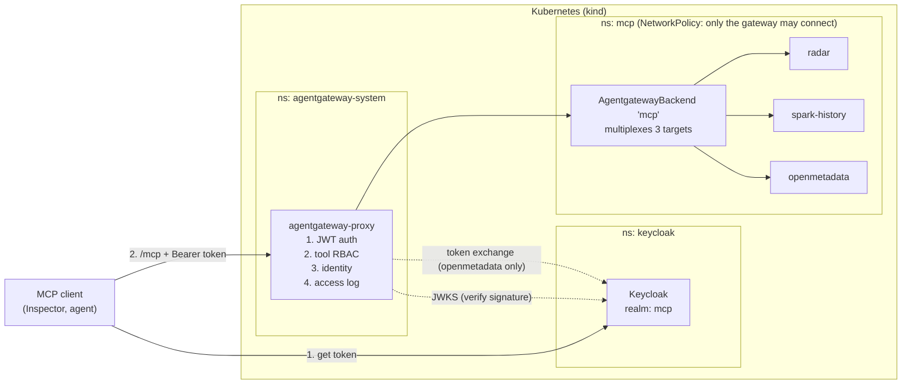
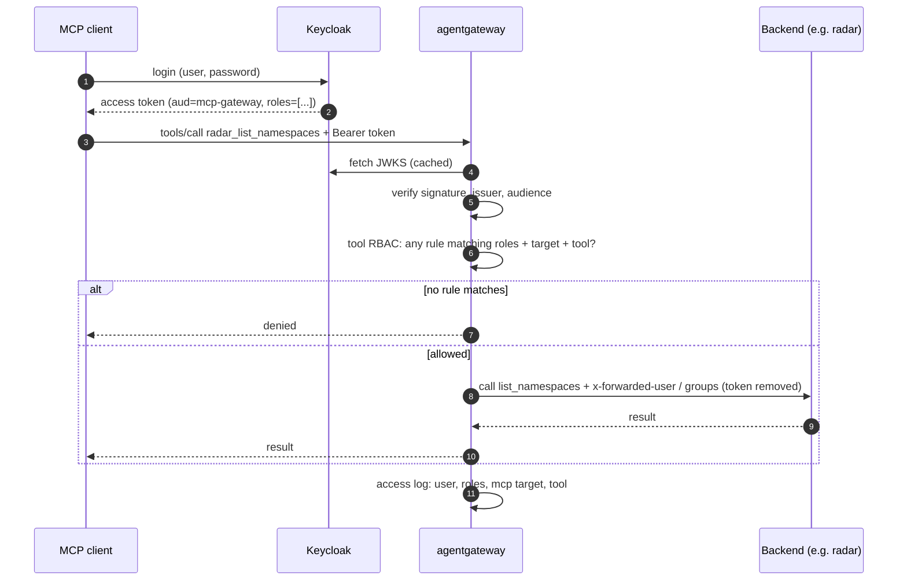

# MCP Gateway RBAC

Deploys [agentgateway](https://agentgateway.dev) (Helm charts v1.5.0) on a local Kubernetes cluster so that:

- every caller sees and can call **only the MCP tools their role allows**, and
- every backend **knows who the caller is**.

Keycloak is the identity provider. **We write no gateway code**: the project is configuration (YAML), mock backends and tests.

> **Status:** the configs in `local-docs/mcp-gateway-guideline.md` are a starting point checked against vendor docs, **not yet run**. Fields marked *check* there must be confirmed against the installed versions.

## Architecture



Request sequence for one tool call:



A request passes through a chain of checkpoints, and each one answers a different question:

| Checkpoint | Question | Where it lives |
|---|---|---|
| Network | Can this pod reach the backend at all? | `deploy/network/` |
| Authentication | Is the token genuine, for this audience? | `deploy/keycloak/`, `deploy/auth/` |
| Authorization | May this role call this tool? | `rbac/tool-access.yaml` |
| Identity | What does the backend learn about the caller? | `deploy/auth/` (headers), `deploy/identity/` (token exchange) |
| Audit | What happened, and who did it? | `observability/access-logs/` |

### Key behaviours

- **One endpoint.** Clients only talk to `/mcp` on the gateway. Tools from all backends appear as `{target}_{tool}`, e.g. `radar_list_namespaces`, `openmetadata_search_metadata`.
- **Roles live in Keycloak** as client roles on `mcp-gateway` (`data_admin`, `data_engineer`, `bi_engineer`, `analyst`) and arrive in the token's `roles` claim.
- **Rules are OR-ed.** Someone with several roles gets the union. No matching rule means no access.
- **The caller's token never reaches a backend.** Backends get identity either by headers (`x-forwarded-user`, `x-forwarded-groups`) or by an exchanged token scoped to that backend (OpenMetadata).
- **Backends are reachable only through the gateway**, which is what makes the identity headers trustworthy.

## Folder structure

```
deploy/            everything `kubectl apply`-able, one folder per concern
  cluster/           kind config (Calico if the default CNI doesn't enforce NetworkPolicy)
  agentgateway/      Gateway, AgentgatewayBackend, HTTPRoute
  keycloak/          dev-mode Deployment + realm setup script
  auth/              JWT authentication + identity-header transformation
  identity/          token exchange for backends that need it
  network/           NetworkPolicy: backends accept only the gateway
rbac/
  tool-access.yaml   source of truth: role -> tools
servers/           mock MCP backends, one folder per target name
  radar/  spark-history/  openmetadata/
observability/
  access-logs/       caller, roles and MCP fields on every log line
tests/
  expected/          the role x tool allow/deny matrix, as data
  inspector/         scripted MCP Inspector calls per test user
  curl/              hand-built edge cases (forged headers, batches)
scripts/           get a token, run all tests
docs/              architecture and implementation plan
local-docs/        deployment guideline (commands per step) and personal notes
evidence/          screenshots/logs for the report
```

Each folder matches one checkpoint or build step, so a failing test points to one folder. Policy (`rbac/`) is kept apart from infrastructure (`deploy/`) because it changes often and needs its own review trail.

## How to leverage it

Follow the build order in [local-docs/mcp-gateway-guideline.md](local-docs/mcp-gateway-guideline.md). Verify each layer before adding the next:

1. **Install** the Gateway API CRDs, agentgateway and the `Gateway` (guideline §1). Check: the proxy is running and port-forward to `8080` works.
2. **Connect backends** (§2). Check: with no auth, `tools/list` at `http://localhost:8080/mcp` shows every tool as `{target}_{tool}`.
3. **Keycloak** (§3). Check: a token for `multi.user` has `roles: ["data_engineer", "bi_engineer"]`.
4. **Auth and tool access** (§4). Check: no token is rejected, and each test user sees only their tools.
5. **Caller identity** (§5). Check: the radar mock logs the token's user, not a forged header.
6. **Network** (§6). Check: a pod outside the gateway cannot reach a backend.
7. **Access logs** (§7), then **test with MCP Inspector** (§8).

### Common changes

| I want to... | Change |
|---|---|
| Give a role access to more tools | Edit `rbac/tool-access.yaml`, **and** `tests/expected/` in the same PR |
| Add a new role | New client role on `mcp-gateway` in Keycloak; add a rule only when it needs access |
| Put someone in a role | Group or user role mapping in Keycloak. No gateway change |
| Add a backend (e.g. Airflow, dbt) | `servers/<name>/`, a Service with `appProtocol: agentgateway.dev/mcp`, a new entry under `targets`, an identity mode, rules and tests |
| Swap a mock for the real server | Point the Service at it. Target name, rules and tests stay the same |

Keep the target name identical across the backend target, the tool prefix, the RBAC rule, `servers/<name>/` and the tests.

### Test users

| User | Roles |
|---|---|
| `analyst.user` | `analyst` (direct) |
| `engineer.user` | `data_engineer` (via group `data-team`) |
| `multi.user` | `data_engineer` + `bi_engineer` (groups `data-team`, `bi-team`) |
| `admin.user` | `data_admin` (direct) |
| `nobody.user` | none |

### Trying it

Always point clients at the gateway's `/mcp`, never at a backend, and send a token:

```bash
npx @modelcontextprotocol/inspector --cli "http://localhost:8080/mcp" --transport http \
  --header "Authorization: Bearer $TOKEN" --method tools/list
```

The admin UI at `http://localhost:15000/ui/` is read-only and for debugging only.

## Requirements

`kind`, `kubectl`, `helm`, Node 22.19+ (MCP Inspector), `curl`, `jq`. Keycloak ≥ 26.2 (needed for standard token exchange).

## Docs

- [Deployment guideline](local-docs/mcp-gateway-guideline.md): commands and config for each step
- [Architecture](docs/02-architecture.md) and [implementation plan](docs/03-implementation-plan.md): design reasoning, backends, tests, tasks, risks
