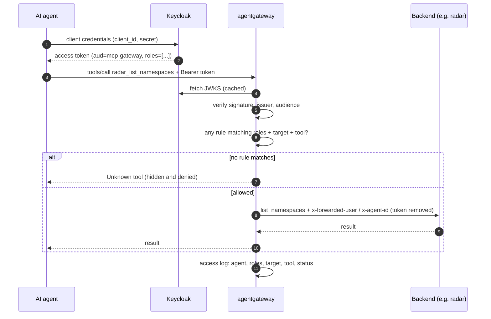

<div align="center">

# MCP Gateway RBAC

**One authenticated, role-filtered MCP endpoint for every AI agent and every tool.**

<p>
  <a href="https://agentgateway.dev"></a>
  <a href="https://modelcontextprotocol.io"></a>
  <a href="https://www.keycloak.org"></a>
  
</p>
<p>
  <a href="https://kind.sigs.k8s.io"><img src="https://img.shields.io/badge/Kubernetes-kind-326CE5?style=for-the-badge&labelColor=1F2328&logo=data%3Aimage%2Fsvg%2Bxml%3Bbase64%2CPHN2ZyB4bWxucz0iaHR0cDovL3d3dy53My5vcmcvMjAwMC9zdmciIHZpZXdCb3g9IjAgMCAxMjggMTI4Ij48cGF0aCBmaWxsPSIjMzI2Y2U1IiBkPSJNNjMuNTU2IDEuOTEyYTguNTEgOC40NCAwIDAgMC0zLjI2LjgyNkwxNS43OTUgMjRhOC41MSA4LjQ0IDAgMCAwLTQuNjA0IDUuNzI1TC4yMTQgNzcuNDg1YTguNTEgOC40NCAwIDAgMCAxLjE1NSA2LjQ3IDguNTEgOC40NCAwIDAgMCAuNDg0LjY3MmwzMC44IDM4LjI5NmE4LjUxIDguNDQgMCAwIDAgNi42NTMgMy4xNzZsNDkuMzk0LS4wMTJhOC41MSA4LjQ0IDAgMCAwIDYuNjUzLTMuMTdsMzAuNzg5LTM4LjMwMWE4LjUxIDguNDQgMCAwIDAgMS42NDUtNy4xNDJsLTEwLjk5Ni00Ny43NmE4LjUxIDguNDQgMCAwIDAtNC42MDQtNS43MjZMNjcuNjgyIDIuNzM4YTguNTEgOC40NCAwIDAgMC00LjEyNi0uODI2eiIvPjxwYXRoIGZpbGw9IiNmZmYiIGQ9Ik02My45NzUgMTguMTQzdi4wMWMtMS40NzIuMDE0LTIuNjY0IDEuMzM2LTIuNjY0IDIuOTcyIDAgLjAyOC4wMDUuMDUyLjAwNS4wNzQtLjAwMi4yMjItLjAxMi40OS0uMDA1LjY4NC4wMzUuOTQ2LjI0IDEuNjY4LjM2NSAyLjUzNS4xNyAxLjQyLjIxNSAyLjU0Ny4yMjQgMy42ODdsLjAzNi0uMTY0YTQwLjkwOSA0MC45MDkgMCAwIDAtLjExOC0yLjM5NGMuMTM5IDEuMjI4LjI0IDIuMzY0LjE4NiAzLjM5Mi0uMDE1LS4zMjUtLjA2MS0uNjc3LS4wNjYtLjk4MmwtLjAzNi4xNjRjLjAwMy4zNDcuMDk2Ljc5LjA2OSAxLjEyMy0uMDYxLjI5LS4yOTEuNDk1LS40NjcuNzQybC0uMDI1LjEyMWMuMTczLS4yMjcuMzU0LS40NDQuNDYtLjY5OS0uMTM0LjQyMy0uNDIuNzk2LS43MDcgMS4wOTQuMDgtLjEyNC4xNDYtLjI2Mi4yNC0uMzg1bC4wMjYtLjEyYy0uMTQ1LjIwMy0uMjI3LjQ1Ny0uMzg1LjYxbC0uMDA2LjAwNi0uMDY0IDEuMTJhMzQuNzAyIDM0LjcwMiAwIDAgMC00Ljc5Ny43MzYgMzQuMjc5IDM0LjI3OSAwIDAgMC0xNy4zOTggOS45MzVjLS4yOTYtLjIwMi0uOC0uNTYtLjk1LS42NzJsLS4wMDUtLjAwNS0uMDEuMDAyYy0uNDc4LjA2NC0uOTUuMjA3LTEuNTctLjE1My0xLjE4Ny0uOC0yLjI3MS0xLjkwNy0zLjU4NC0zLjI0LS42MDEtLjYzNy0xLjAzNy0xLjI0Ni0xLjc1NC0xLjg2MS0uMTYzLS4xNDEtLjQxLS4zMy0uNTkyLS40NzNhMy4xOTMgMy4xOTMgMCAwIDAtMS44Ny0uNzA1Yy0uODI1LS4wMjgtMS42Mi4yOTQtMi4xNC45NDctLjkyNSAxLjE2LS42MjggMi45MzMuNjU4IDMuOTZsLjA0LjAyNmMuMTc0LjE0My4zOS4zMjYuNTUyLjQ0Ni43NjIuNTYxIDEuNDU3Ljg0OSAyLjIxIDEuMjkzIDEuNTk0Ljk4NCAyLjkxIDEuNzk4IDMuOTU2IDIuNzc5LjQwMi40MjcuNDc0IDEuMTkuNTMgMS41MjV2LjAwOGwuODQ3Ljc1NGMtNC41NjEgNi44NzQtNi42NzUgMTUuMzYtNS40MzIgMjQuMDA2bC0xLjEwMy4zMjQtLjAwNC4wMDZjLS4yOTUuMzgxLS43MTIuOTcyLTEuMTM1IDEuMTQ3LTEuMzY2LjQzLTIuOTA4LjU4OC00Ljc3Ljc4My0uODcyLjA3My0xLjYyNi4wMzEtMi41NTYuMjA3LS4yMDUuMDQtLjQ5LjExMi0uNzEzLjE2NGwtLjAyMy4wMDYtLjA0LjAxMWMtMS41OC4zODMtMi42IDEuODM3LTIuMjcgMy4yNzIuMzI3IDEuNDM1IDEuODczIDIuMzA2IDMuNDY0IDEuOTYzbC4wMzktLjAwNmguMDAyYy4wMi0uMDA1LjAzOC0uMDE1LjA1LS4wMTguMjItLjA0OC40OTYtLjEwMS42OS0uMTU0LjkxMy0uMjQ1IDEuNTc0LS42MDMgMi4zOTMtLjkxNiAxLjc2LS42MzIgMy4yMTgtMS4xNiA0LjYzNy0xLjM2NS41ODItLjA0NiAxLjIwNC4zNjIgMS41MTcuNTM3bC4wMDguMDA0IDEuMTUyLS4xOTdjMi42NzQgOC4yNzQgOC4yNjYgMTQuOTYgMTUuMzQ2IDE5LjE2MmwtLjQ4IDEuMTUyLjAwMy4wMWMuMTc0LjQ1LjM2NCAxLjA1Ny4yMzcgMS40OTItLjUxNiAxLjMzNi0xLjQgMi43NDktMi40MDggNC4zMjYtLjQ4OC43MjgtLjk5IDEuMjk1LTEuNDMgMi4xMzEtLjEwNy4yMDEtLjI0LjUwNy0uMzQyLjcxNy0uNjkgMS40NzUtLjE4NCAzLjE3NyAxLjE0MyAzLjgxNiAxLjMzNS42NDMgMi45OS0uMDM2IDMuNzA3LTEuNTEzbC4wMDctLjAwOHYtLjAxYy4xLS4yMDcuMjQyLS40NzguMzI5LS42NzQuMzc4LS44NjYuNTA1LTEuNjA3Ljc3LTIuNDQxaC0uMDAzYy43MDYtMS43NzMgMS4wOTQtMy42MjcgMi4wNTktNC43NzguMjYtLjMxLjY4OC0uNDMyIDEuMTM2LS41NTJsLjAxLS4wMDQuNi0xLjA4NGEzNC40MzYgMzQuNDM2IDAgMCAwIDI0LjU1Ni4wNjJjLjE3Mi4zMDMuNDc4Ljg2NS41NjMgMS4wMWwuMDA0LjAwNi4wMDguMDA0Yy40NTguMTQ5Ljk0OC4yMjMgMS4zNS44MTYuNzIyIDEuMjM3IDEuMjE4IDIuNzAzIDEuODIyIDQuNDc1LjI2NS44MzIuMzk3IDEuNTc1Ljc3NSAyLjQ0MS4wODcuMi4yMy40NzUuMzMuNjg0LjcxNSAxLjQ4MiAyLjM3NSAyLjE2MyAzLjcxMyAxLjUyIDEuMzI2LS42NCAxLjgzMi0yLjM0IDEuMTQzLTMuODE1LS4xMDItLjIxLS4yNDMtLjUxOC0uMzQ4LS43MTktLjQ0MS0uODM2LS45NDMtMS4zOTctMS40My0yLjEyNS0xLjAxLTEuNTc3LTEuODQzLTIuODg1LTIuMzYtNC4yMjItLjIxMy0uNjg1LjAzNi0xLjEwNC4yMDYtMS41NTVsLjAwNi0uMDE0LS4wMS0uMDFhLjgzNC44MzQgMCAwIDEtLjA5LS4xNjggNi4yMyA2LjIzIDAgMCAxLS4xMi0uMjljLS4wOC0uMjEtLjE2LS40NDItLjIyNC0uNTk2IDcuMzU4LTQuMzUgMTIuNzg2LTExLjI4NSAxNS4zNC0xOS4yOTUuMzQ3LjA1NC45My4xNTUgMS4xMi4xOTNsLjAxLjAwMi4wMDktLjAwNGMuNDAyLS4yNjUuNzYtLjYwNiAxLjQ3NS0uNTQ5IDEuNDE5LjIwNSAyLjg3Ni43MzQgNC42MzggMS4zNjYuODE3LjMxMiAxLjQ3OS42NzcgMi4zOTMuOTIxLjE5NC4wNTIuNDcuMTAxLjY5LjE0OS4wMTIuMDAzLjAyOS4wMTIuMDUuMDE3aC4wMDJsLjA0LjAwNGMxLjU5LjM0MSAzLjEzNy0uNTI4IDMuNDY0LTEuOTYzLjMyNy0xLjQzNS0uNjkxLTIuODg4LTIuMjcyLTMuMjY5LS4yMjctLjA1Mi0uNTUxLS4xNDEtLjc3NS0uMTg0LS45My0uMTc2LTEuNjgzLS4xMzItMi41NTctLjIwNS0xLjg2LS4xOTUtMy40MDItLjM1My00Ljc3LS43ODMtLjU0Ny0uMjEzLS45NDItLjg3Mi0xLjEzOC0xLjE0OGwtLjAwNi0uMDA2LTEuMDY2LS4zMWEzNC40MiAzNC40MiAwIDAgMC0uNTYtMTIuNDI1IDM0LjQ5NyAzNC40OTcgMCAwIDAtNC45ODMtMTEuNTI1Yy4yNzgtLjI1Mi43ODUtLjcwMS45MzItLjgzNmwuMDA3LS4wMDZ2LS4wMWMuMDQ0LS40OC4wMDYtLjk3LjQ5NS0xLjQ5NCAxLjA0NS0uOTggMi4zNjQtMS43OTcgMy45NTctMi43NzkuNzU0LS40NDQgMS40NTQtLjczMSAyLjIxNC0xLjI5My4xNzQtLjEyOC40MDgtLjMyOC41ODgtLjQ3MyAxLjI4Ni0xLjAyNiAxLjU4NC0yLjc5OC42NTgtMy45NTktLjkyNS0xLjE2LTIuNzE4LTEuMjY3LTQuMDAzLS4yNDItLjE4Mi4xNDUtLjQzLjMzMi0uNTk0LjQ3My0uNzE3LjYxOC0xLjE2IDEuMjI2LTEuNzYgMS44NjMtMS4zMTMgMS4zMzUtMi4zOTggMi40NDYtMy41ODYgMy4yNDYtLjUwNy4yOTQtMS4yNTguMTkzLTEuNjAzLjE3MmgtLjAwOGwtMS4wMDQuNzE5Yy01Ljc3NS02LjA0OC0xMy42My05LjkxNi0yMi4wOS0xMC42NzJhNjMuNTQzIDYzLjU0MyAwIDAgMS0uMDY0LTEuMTc0di0uMDA4bC0uMDA2LS4wMDZjLS4zNS0uMzMzLS43Ni0uNjEtLjg2NC0xLjMxOHYtLjAwMmMtLjExNS0xLjQyOC4wNzctMi45NjcuMy00LjgyNC4xMjUtLjg2Ny4zMzItMS41OS4zNjYtMi41MzUuMDA5LS4yMTYtLjAwNS0uNTI3LS4wMDUtLjc1OCAwLTEuNjQ1LTEuMjAzLTIuOTgyLTIuNjg4LTIuOTgyem0tMy41MTQgMTMuN2EzNC42NjMgMzQuNjYzIDAgMCAwLTMuNTkuNTUyIDM0LjYxOCAzNC42MTggMCAwIDEgMy41OS0uNTUxem0tNC43ODEuODIzYTM0LjI2MiAzNC4yNjIgMCAwIDAtMy43MTEgMS4xMzMgMzQuMjA4IDM0LjIwOCAwIDAgMSAzLjcxLTEuMTMzem0tNC44MjUgMS41NjRhMzQuMjYyIDM0LjI2MiAwIDAgMC0zLjQ5NiAxLjY2NiAzNC4yMTYgMzQuMjE2IDAgMCAxIDMuNDk2LTEuNjY2ek0yOC44IDM1LjM3N2MuMTQyLjAyLjI4LjA0OC40MTguMDg2YTMuMTY4IDMuMTY4IDAgMCAwLS40MTgtLjA4NnptLjk0My4yODNjLjEzMi4wNjQuMjU5LjEzNy4zOC4yMTlhMy4xNjggMy4xNjggMCAwIDAtLjM4LS4yMTl6bTE2LjU0OS44NDhhMzQuMjYyIDM0LjI2MiAwIDAgMC0zLjE3NiAyLjE0IDM0LjIyOCAzNC4yMjggMCAwIDEgMy4xNzYtMi4xNHptMTQuMzQ2IDIuMzQ0LS43ODcgMTMuOTMtLjA1Ny4wMjktLjAwMi4wMTNjLS4wMDIuMDUtLjAxNC4wOTUtLjAyLjE0M2EyLjM0OCAyLjM0OCAwIDAgMS0uMjYzLjg1N2MtLjAzOC4wNy0uMDc2LjE0MS0uMTIxLjIwN2EyLjM0OCAyLjM0OCAwIDAgMS0uNjkuNjYyYy0uMDcuMDQ1LS4xNDcuMDgtLjIyMi4xMThhMi4zNDggMi4zNDggMCAwIDEtLjg3My4yMjZjLS4wNDUuMDAzLS4wODguMDE0LS4xMzMuMDE0LS4wNSAwLS4wOTQtLjAyMi0uMTQzLS4wMjZhMi4zMzQgMi4zMzQgMCAwIDEtLjk0My0uMzA0Yy0uMDQ1LS4wMjYtLjA5NC0uMDQxLS4xMzctLjA2OWwtLjAwNi4wMjIuMDA0LS4wMjJjLS4wNDQtLjAyNy0uMTAyLS4wMTYtLjE0NC0uMDQ3bC0uMDEyLS4wMS0uMDIyLjAxNC0xMS40MjEtOC4wOTdjLjA5My0uMDkxLjE5Mi0uMTc0LjI4Ny0uMjY0YTI3LjQzOCAyNy40MzggMCAwIDEgMy4yMy0yLjYzNWMuMjM3LS4xNjUuNDczLS4zMzIuNzE1LS40OWEyNy40MzggMjcuNDM4IDAgMCAxIDMuODE2LTIuMDc4Yy4yNC0uMTA3LjQ4Ny0uMjA0LjczLS4zMDVhMjcuNDM4IDI3LjQzOCAwIDAgMSA0LjA0NC0xLjMxMmMuMTItLjAzLjIzOC0uMDY3LjM2LS4wOTQuNTc2LS4xMyAxLjE2Mi0uMjA2IDEuNzQ1LS4yOTlsLjAwNi0uMDI1YTI4LjA3NiAyOC4wNzYgMCAwIDEgLjAwNCAwbC0uMDA2LjAyNWMuMzU1LS4wNTYuNzA0LS4xNCAxLjA2LS4xODN6bTYuNzI2LjAwMmMuMTk3LjAyNC4zOS4wNjguNTg2LjA5N2EyNy42NjggMjcuNjY4IDAgMCAxIDMuMTYuNjU2Yy40MTIuMTExLjgyLjIzIDEuMjI1LjM2YTI3LjY2OCAyNy42NjggMCAwIDEgMy4wMzMgMS4xNjhjLjM3NS4xNy43NDUuMzQ4IDEuMTEyLjUzNWEyNy42NjggMjcuNjY4IDAgMCAxIDIuODMgMS42NjJjLjM0NC4yMy42OC40NyAxLjAxNS43MTdhMjcuNjY4IDI3LjY2OCAwIDAgMSAyLjQ5NiAyLjA3NGMuMTQ0LjEzNC4yOTcuMjU3LjQzOC4zOTVsLTExLjM0NiA4LjA0NC0uMDQtLjAxNS0uMDEuMDA4Yy0uMDQ1LjAzMi0uMDk0LjA0NS0uMTQuMDc0YTIuMzUgMi4zNSAwIDAgMS0uODgyLjMzNGMtLjA3Ny4wMTItLjE1My4wMy0uMjMuMDMzYTIuMzUgMi4zNSAwIDAgMS0uOTktLjE3NiAyLjM0IDIuMzQgMCAwIDEtLjI2NS0uMTI3IDIuMzUgMi4zNSAwIDAgMS0uNzQ2LS42NWMtLjA1LS4wNjktLjA4OC0uMTQ2LS4xMy0uMjJhMi4zNSAyLjM1IDAgMCAxLS4yODgtLjg4N2MtLjAwNi0uMDU1LS4wMjYtLjEwMy0uMDMtLjE1OXYtLjAxMWwtLjAxMS0uMDA2em0tMjUuMjM4LjU3NmEzNC4yNjIgMzQuMjYyIDAgMCAwLTIuODEgMi41NzYgMzQuMjI4IDM0LjIyOCAwIDAgMSAyLjgxLTIuNTc2em01MC45MTYgOC4xNGEzNC40ODMgMzQuNDgzIDAgMCAxIDEuNTIyIDIuNTk0IDM0LjQ3OCAzNC40NzggMCAwIDAtMS41MjItMi41OTR6bTEuOTk0IDMuNTA4Yy40ODguOTkzLjkyNyAyLjAxIDEuMzE3IDMuMDQ1YTM0LjQ3OCAzNC40NzggMCAwIDAtMS4zMTctMy4wNDV6bS01NC41NzYuNjkgMTAuNDMgOS4zMjgtLjAxMi4wNTYuMDEuMDA4Yy45NC44MTcgMS4wNyAyLjIzLjI5MyAzLjIwMy0uMDI4LjAzNS0uMDY4LjA1Ny0uMDk4LjA5YTIuMzQ4IDIuMzQ4IDAgMCAxLS45ODYuNjVjLS4wNDMuMDE1LS4wNzguMDQzLS4xMjEuMDU1bC0uMDE0LjAwMi0uMDEyLjA0Ny0xMy4zNjcgMy44NmMtLjAyLS4xODUtLjAyLS4zNy0uMDM3LS41NTVhMjcuNDMyIDI3LjQzMiAwIDAgMS0uMDkyLTMuMzQ0Yy4wMTMtLjM4Ny4wMzMtLjc3My4wNjMtMS4xNThhMjcuNDMyIDI3LjQzMiAwIDAgMSAuNDU3LTMuMzA3Yy4wOC0uNDA3LjE3My0uODEyLjI3My0xLjIxNWEyNy40MzIgMjcuNDMyIDAgMCAxIC45OS0zLjE2MmMuMTQtLjM3LjI5LS43MzQuNDQ4LTEuMDk3YTI3LjQzMiAyNy40MzIgMCAwIDEgMS41MS0yLjk4N2MuMDktLjE1Ni4xNy0uMzIuMjY1LS40NzR6bTQ3LjAwMi4wMDdjLjA5Ny4xNTguMTc2LjMyNC4yNy40ODNhMjcuNzc0IDI3Ljc3NCAwIDAgMSAxLjUzIDMuMDFjLjE1LjM0Ni4yOTguNjk0LjQzNCAxLjA0NmEyNy43NzQgMjcuNzc0IDAgMCAxIDEuMDQgMy4yODhjLjA0NS4xNzUuMTA0LjM0Ni4xNDQuNTIzLjY5IDMuMDAyLjg2IDUuOTk5LjU3OCA4Ljg5NmwtMTMuNDM0LTMuODctLjAxMS0uMDU3LS4wMTQtLjAwNGMtLjA0NS0uMDEyLS4wODQtLjAzNC0uMTI3LS4wNDlhMi4zNSAyLjM1IDAgMCAxLS43OS0uNDU1Yy0uMDU4LS4wNTItLjExNi0uMTAzLS4xNy0uMTZhMi4zNSAyLjM1IDAgMCAxLS40OTEtLjgyNGMtLjAyNy0uMDc4LS4wNDQtLjE1OC0uMDYzLS4yMzlhMi4zNSAyLjM1IDAgMCAxLS4wMy0uODkyYy4wMDktLjA0OS4wMS0uMDk2LjAyLS4xNDUuMDEtLjA0NS4wMzgtLjA4NC4wNS0uMTI5YTIuMzI5IDIuMzI5IDAgMCAxIC41OTktLjk5NmMuMDM0LS4wMzMuMDU0LS4wNzYuMDktLjEwN2wuMDEtLjAxLS4wMDYtLjAzIDEwLjM3LTkuMjc5em05LjIyOCAzLjMwNWMuMzMyLjk2NS42MTkgMS45NDUuODY0IDIuOTM4YTM0LjQ3OCAzNC40NzggMCAwIDAtLjg2NC0yLjkzOHptLTM0LjgyNCA2Ljc1Mmg0LjI2MmwyLjY1IDMuMzE0LS45NSA0LjEzMy0zLjgzIDEuODQtMy44MzctMS44NDgtLjk1My00LjEzMnptMTMuNzI3IDExLjM5NWMuMTgtLjAxLjM1Ny4wMDguNTMzLjA0bC4wMTQuMDAzLjAyMy0uMDMgMTMuODI4IDIuMzM4Yy0uMDY0LjE4LS4xNDcuMzUxLS4yMTUuNTNhMjcuNDY2IDI3LjQ2NiAwIDAgMS0xLjM2IDMuMDExYy0uMTkuMzYzLS4zODYuNzIxLS41OTMgMS4wNzRhMjcuNDY2IDI3LjQ2NiAwIDAgMS0xLjg1MyAyLjc2OGMtLjI0My4zMi0uNDkyLjYzMy0uNzQ4Ljk0MWEyNy40NjYgMjcuNDY2IDAgMCAxLTIuMjkgMi40MzJjLS4yOS4yNzQtLjU4OC41NC0uODkyLjhhMjcuNDY2IDI3LjQ2NiAwIDAgMS0yLjY0IDIuMDEyYy0uMTYuMTA3LS4zMS4yMjUtLjQ3MS4zMjlsLTUuMzY1LTEyLjk2Ny4wMTUtLjAyMi0uMDA0LS4wMTFjLS4wMi0uMDQ1LS4wMjYtLjA5Mi0uMDQzLS4xMzdhMi4zNTEgMi4zNTEgMCAwIDEtLjEzNS0uODg5Yy4wMDQtLjA4MS4wMDYtLjE2Mi4wMTgtLjI0MmEyLjM1MSAyLjM1MSAwIDAgMSAuMzM0LS44OWMuMDQ1LS4wNzIuMDk4LS4xMzcuMTUtLjIwNGEyLjM1MSAyLjM1MSAwIDAgMSAuNjgtLjU3OGMuMDQzLS4wMjQuMDc5LS4wNTUuMTIzLS4wNzYuMjg5LS4xMzkuNTktLjIxOC44OS0uMjMyem0tMjMuMzEuMDU2LjAxMy4wMDJjLjAzIDAgLjA2LjAwOC4wOTIuMDFhMi4zNDkgMi4zNDkgMCAwIDEgMS4yMjYuNDQ1Yy4wNy4wNS4xMzMuMTAxLjE5Ni4xNThhMi4zNDkgMi4zNDkgMCAwIDEgLjY4OSAxLjEwNmMuMDA4LjAzLjAyMi4wNTkuMDMuMDkuMTEuNDc5LjA2NS45OC0uMTMgMS40MzFsLS4wMDUuMDEyLjA0LjA1LTUuMzEgMTIuODM3Yy0uMTU1LS4xLS4zLS4yMTItLjQ1MS0uMzE1YTI3LjU4IDI3LjU4IDAgMCAxLTIuNjQtMi4wMTEgMjcuNTA4IDI3LjUwOCAwIDAgMS0uODkxLS44MDMgMjcuNTggMjcuNTggMCAwIDEtMi4yNzItMi40MDhjLS4yNi0uMzEyLS41MTMtLjYyOS0uNzYtLjk1MWEyNy41OCAyNy41OCAwIDAgMS0xLjgyLTIuNzA0IDI3LjI5NCAyNy4yOTQgMCAwIDEtLjYyNy0xLjEyMyAyNy41OCAyNy41OCAwIDAgMS0xLjM0Ni0yLjk0N2MtLjA3LS4xODEtLjE1NC0uMzU2LS4yMi0uNTM5bDEzLjcwNy0yLjMyNi4wMjMuMDMuMDE0LS4wMDVjLjE0Ny0uMDI3LjI5NC0uMDQuNDQzLS4wMzl6bTIuMzA0IDEuOTk0YTIuMzI2IDIuMzI2IDAgMCAxIC4wMi4zNDQgMi4yODYgMi4yODYgMCAwIDAtLjAyLS4zNDR6bS0uMDA4LjcwM2EyLjMyNiAyLjMyNiAwIDAgMS0uMS40Yy4wNDYtLjEzLjA3Ny0uMjY0LjEtLjR6bTkuMzM0IDIuOTQ0Yy4wNTgtLjAwMi4xMTQuMDEzLjE3Mi4wMTVhMi4zMiAyLjMyIDAgMCAxIC43NTIuMTU5Yy4wNTQuMDIxLjExMi4wMy4xNjQuMDU2di4wMDJhMi4zMSAyLjMxIDAgMCAxIDEuMDQzLjk5bC4wMDYuMDEyaC4wNTNsNi43NTcgMTIuMjEzYy0uMjc2LjA5Mi0uNTU3LjE3My0uODM2LjI1NmEyOC4wNTYgMjguMDU2IDAgMCAxLS45OTYuMjc3Yy0uMjgzLjA3NC0uNTY0LjE1LS44NS4yMTUtLjEyNC4wMjktLjI1LjA0Ni0uMzc2LjA3MmEyNy41NDIgMjcuNTQyIDAgMCAxLTQuMTguNTYxYy0uMjguMDE2LS41NTguMDM1LS44MzguMDQzYTI3LjU0MiAyNy41NDIgMCAwIDEtNC4zMi0uMjIzYy0uMjgtLjAzNi0uNTYtLjA4NS0uODM4LS4xM2EyNy41NDIgMjcuNTQyIDAgMCAxLTQuMDU1LS45NzVjLS4xMjctLjA0MS0uMjU3LS4wNzItLjM4NC0uMTE1bDYuNzQyLTEyLjE4OGguMDFsLjAwNy0uMDEyYy4wMjYtLjA0OC4wNjUtLjA4NS4wOTQtLjEzYTIuMzUxIDIuMzUxIDAgMCAxIC42MDYtLjY0N2MuMDgzLS4wNi4xNjgtLjExNS4yNi0uMTY0YTIuMzUxIDIuMzUxIDAgMCAxIC44NS0uMjYyYy4wNTQtLjAwNS4xMDMtLjAyMy4xNTctLjAyNXpNNTIuMjk3IDk4LjY5YTM0LjQxMyAzNC40MTMgMCAwIDAgMy43NTggMS4xMzcgMzQuMzUyIDM0LjM1MiAwIDAgMS0zLjc1OC0xLjEzN3ptMjMuMzg1LjA5Yy0xLjA3LjM4MS0yLjE1Ni43MDktMy4yNTguOTgzYTM0LjU2IDM0LjU2IDAgMCAwIDMuMjU4LS45ODN6bS00LjU3NSAxLjI4MWEzNC4zOTkgMzQuMzk5IDAgMCAxLTMuNzE4LjU2MyAzNC40MTMgMzQuNDEzIDAgMCAwIDMuNzE4LS41NjN6bS0xMy45MzcuMDE2YTM0LjQxMyAzNC40MTMgMCAwIDAgMy44OTguNTcyIDM0LjM1OCAzNC4zNTggMCAwIDEtMy44OTgtLjU3MnptOC45MS42NDlhMzQuMzYgMzQuMzYgMCAwIDEtMy44NTEuMDA1IDM0LjQxMyAzNC40MTMgMCAwIDAgMy44NS0uMDA1eiIvPjwvc3ZnPg%3D%3D" alt="Kubernetes"></a>
  <img src="https://img.shields.io/badge/Docker-Compose-2496ED?style=for-the-badge&labelColor=1F2328&logo=data%3Aimage%2Fsvg%2Bxml%3Bbase64%2CPHN2ZyB4bWxucz0iaHR0cDovL3d3dy53My5vcmcvMjAwMC9zdmciIHZpZXdCb3g9IjAgMCAxMjggMTI4Ij48cGF0aCBmaWxsLXJ1bGU9ImV2ZW5vZGQiIGNsaXAtcnVsZT0iZXZlbm9kZCIgZmlsbD0iIzNBNEQ1NCIgZD0iTTczLjggNTAuOGgxMS4zdjExLjVoNS43YzIuNiAwIDUuMy0uNSA3LjgtMS4zIDEuMi0uNCAyLjYtMSAzLjgtMS43LTEuNi0yLjEtMi40LTQuNy0yLjYtNy4zLS4zLTMuNS40LTguMSAyLjgtMTAuOGwxLjItMS40IDEuNCAxLjFjMy42IDIuOSA2LjUgNi44IDcuMSAxMS40IDQuMy0xLjMgOS4zLTEgMTMuMSAxLjJsMS41LjktLjggMS42Yy0zLjIgNi4yLTkuOSA4LjItMTYuNCA3LjgtOS44IDI0LjMtMzEgMzUuOC01Ni44IDM1LjgtMTMuMyAwLTI1LjUtNS0zMi41LTE2LjhsLS4xLS4yLTEtMi4xYy0yLjQtNS4yLTMuMS0xMC45LTIuNi0xNi42bC4yLTEuN2g5LjZWNTAuOGgxMS4zVjM5LjZoMjIuNVYyOC4zaDEzLjV2MjIuNXoiLz48cGF0aCBmaWxsPSIjMDBBQURBIiBkPSJNMTEwLjQgNTUuMWMuOC01LjktMy42LTEwLjUtNi40LTEyLjctMy4xIDMuNi0zLjYgMTMuMiAxLjMgMTcuMi0yLjggMi40LTguNSA0LjctMTQuNSA0LjdIMTguNmMtLjYgNi4yLjUgMTEuOSAzIDE2LjhsLjggMS41Yy41LjkgMS4xIDEuNyAxLjcgMi42IDMgLjIgNS43LjMgOC4yLjIgNC45LS4xIDguOS0uNyAxMi0xLjcuNS0uMi45LjEgMS4xLjUuMi41LS4xLjktLjUgMS4xLS40LjEtLjguMy0xLjMuNC0yLjQuNy01IDEuMS04LjMgMS4zaC0uNmMtMS4zLjEtMi43LjEtNC4yLjEtMS42IDAtMy4xIDAtNC45LS4xIDYgNi44IDE1LjQgMTAuOCAyNy4yIDEwLjggMjUgMCA0Ni4yLTExLjEgNTUuNS0zNS45IDYuNy43IDEzLjEtMSAxNi02LjctNC41LTIuNy0xMC41LTEuOC0xMy45LS4xeiIvPjxwYXRoIGZpbGw9IiMyOEI4RUIiIGQ9Ik0xMTAuNCA1NS4xYy44LTUuOS0zLjYtMTAuNS02LjQtMTIuNy0zLjEgMy42LTMuNiAxMy4yIDEuMyAxNy4yLTIuOCAyLjQtOC41IDQuNy0xNC41IDQuN2gtNjhjLS4zIDkuNSAzLjIgMTYuNyA5LjUgMjEgNC45LS4xIDguOS0uNyAxMi0xLjcuNS0uMi45LjEgMS4xLjUuMi41LS4xLjktLjUgMS4xLS40LjEtLjguMy0xLjMuNC0yLjQuNy01LjIgMS4yLTguNSAxLjRsLS4xLS4xYzguNSA0LjQgMjAuOCA0LjMgMzUtMS4xIDE1LjgtNi4xIDMwLjYtMTcuNyA0MC45LTMwLjktLjIuMS0uNC4xLS41LjJ6Ii8%2BPHBhdGggZmlsbD0iIzAyOEJCOCIgZD0iTTE4LjcgNzEuOGMuNCAzLjMgMS40IDYuNCAyLjkgOS4zbC44IDEuNWMuNS45IDEuMSAxLjcgMS43IDIuNiAzIC4yIDUuNy4zIDguMi4yIDQuOS0uMSA4LjktLjcgMTItMS43LjUtLjIuOS4xIDEuMS41LjIuNS0uMS45LS41IDEuMS0uNC4xLS44LjMtMS4zLjQtMi40LjctNS4yIDEuMi04LjUgMS40aC0uNGMtMS4zLjEtMi43LjEtNC4xLjEtMS42IDAtMy4yIDAtNC45LS4xIDYgNi44IDE1LjUgMTAuOCAyNy4zIDEwLjggMjEuNCAwIDQwLTguMSA1MC44LTI2SDE4Ljd2LS4xeiIvPjxwYXRoIGZpbGw9IiMwMTlCQzYiIGQ9Ik0yMy41IDcxLjhjMS4zIDUuOCA0LjMgMTAuNCA4LjggMTMuNSA0LjktLjEgOC45LS43IDEyLTEuNy41LS4yLjkuMSAxLjEuNS4yLjUtLjEuOS0uNSAxLjEtLjQuMS0uOC4zLTEuMy40LTIuNC43LTUuMiAxLjItOC42IDEuNCA4LjUgNC40IDIwLjggNC4zIDM0LjktMS4xIDguNS0zLjMgMTYuOC04LjIgMjQuMi0xNC4xSDIzLjV6Ii8%2BPHBhdGggZmlsbC1ydWxlPSJldmVub2RkIiBjbGlwLXJ1bGU9ImV2ZW5vZGQiIGZpbGw9IiMwMEFDRDMiIGQ9Ik0yOC40IDUyLjdoOS44djkuOGgtOS44di05Ljh6bS44LjhoLjh2OC4xaC0uOHYtOC4xem0xLjQgMGguOHY4LjFoLS44di04LjF6bTEuNSAwaC44djguMWgtLjh2LTguMXptMS41IDBoLjh2OC4xaC0uOHYtOC4xem0xLjUgMGguOHY4LjFoLS44di04LjF6bTEuNSAwaC44djguMWgtLjh2LTguMXptMy0xMmg5Ljh2OS44aC05Ljh2LTkuOHptLjkuOGguOHY4LjFoLS44di04LjF6bTEuNCAwaC44djguMWgtLjh2LTguMXptMS41IDBoLjh2OC4xaC0uOHYtOC4xem0xLjUgMGguOHY4LjFoLS44di04LjF6bTEuNCAwaC44djguMWgtLjh2LTguMXptMS41IDBoLjh2OC4xaC0uOHYtOC4xeiIvPjxwYXRoIGZpbGwtcnVsZT0iZXZlbm9kZCIgY2xpcC1ydWxlPSJldmVub2RkIiBmaWxsPSIjMjNDMkVFIiBkPSJNMzkuNiA1Mi43aDkuOHY5LjhoLTkuOHYtOS44em0uOS44aC44djguMWgtLjh2LTguMXptMS40IDBoLjh2OC4xaC0uOHYtOC4xem0xLjUgMGguOHY4LjFoLS44di04LjF6bTEuNSAwaC44djguMWgtLjh2LTguMXptMS40IDBoLjh2OC4xaC0uOHYtOC4xem0xLjUgMGguOHY4LjFoLS44di04LjF6Ii8%2BPHBhdGggZmlsbC1ydWxlPSJldmVub2RkIiBjbGlwLXJ1bGU9ImV2ZW5vZGQiIGZpbGw9IiMwMEFDRDMiIGQ9Ik01MC45IDUyLjdoOS44djkuOGgtOS44di05Ljh6bS44LjhoLjh2OC4xaC0uOHYtOC4xem0xLjUgMGguOHY4LjFoLS44di04LjF6bTEuNSAwaC44djguMWgtLjh2LTguMXptMS40IDBoLjh2OC4xaC0uOHYtOC4xem0xLjUgMGguOHY4LjFoLS44di04LjF6bTEuNSAwaC44djguMWgtLjh2LTguMXoiLz48cGF0aCBmaWxsLXJ1bGU9ImV2ZW5vZGQiIGNsaXAtcnVsZT0iZXZlbm9kZCIgZmlsbD0iIzIzQzJFRSIgZD0iTTUwLjkgNDEuNWg5Ljh2OS44aC05Ljh2LTkuOHptLjguOGguOHY4LjFoLS44di04LjF6bTEuNSAwaC44djguMWgtLjh2LTguMXptMS41IDBoLjh2OC4xaC0uOHYtOC4xem0xLjQgMGguOHY4LjFoLS44di04LjF6bTEuNSAwaC44djguMWgtLjh2LTguMXptMS41IDBoLjh2OC4xaC0uOHYtOC4xem0zLjEgMTAuNEg3MnY5LjhoLTkuOHYtOS44em0uOC44aC44djguMUg2M3YtOC4xem0xLjUgMGguOHY4LjFoLS44di04LjF6bTEuNCAwaC44djguMWgtLjh2LTguMXptMS41IDBoLjh2OC4xaC0uOHYtOC4xem0xLjUgMGguOHY4LjFoLS44di04LjF6bTEuNSAwaC44djguMWgtLjh2LTguMXoiLz48cGF0aCBmaWxsLXJ1bGU9ImV2ZW5vZGQiIGNsaXAtcnVsZT0iZXZlbm9kZCIgZmlsbD0iIzAwQUNEMyIgZD0iTTYyLjIgNDEuNUg3MnY5LjhoLTkuOHYtOS44em0uOC44aC44djguMUg2M3YtOC4xem0xLjUgMGguOHY4LjFoLS44di04LjF6bTEuNCAwaC44djguMWgtLjh2LTguMXptMS41IDBoLjh2OC4xaC0uOHYtOC4xem0xLjUgMGguOHY4LjFoLS44di04LjF6bTEuNSAwaC44djguMWgtLjh2LTguMXoiLz48cGF0aCBmaWxsLXJ1bGU9ImV2ZW5vZGQiIGNsaXAtcnVsZT0iZXZlbm9kZCIgZmlsbD0iIzIzQzJFRSIgZD0iTTYyLjIgMzAuMkg3MlY0MGgtOS44di05Ljh6bS44LjhoLjh2OC4xSDYzVjMxem0xLjUgMGguOHY4LjFoLS44VjMxem0xLjQgMGguOHY4LjFoLS44VjMxem0xLjUgMGguOHY4LjFoLS44VjMxem0xLjUgMGguOHY4LjFoLS44VjMxem0xLjUgMGguOHY4LjFoLS44VjMxeiIvPjxwYXRoIGZpbGwtcnVsZT0iZXZlbm9kZCIgY2xpcC1ydWxlPSJldmVub2RkIiBmaWxsPSIjMDBBQ0QzIiBkPSJNNzMuNSA1Mi43aDkuOHY5LjhoLTkuOHYtOS44em0uOC44aC44djguMWgtLjh2LTguMXptMS40IDBoLjh2OC4xaC0uOHYtOC4xem0xLjUgMGguOHY4LjFoLS44di04LjF6bTEuNSAwaC44djguMWgtLjh2LTguMXptMS41IDBoLjh2OC4xaC0uOHYtOC4xem0xLjUgMGguOHY4LjFoLS44di04LjF6Ii8%2BPHBhdGggZmlsbC1ydWxlPSJldmVub2RkIiBjbGlwLXJ1bGU9ImV2ZW5vZGQiIGZpbGw9IiNENEVFRjEiIGQ9Ik00OC44IDc4LjNjMS41IDAgMi43IDEuMiAyLjcgMi43IDAgMS41LTEuMiAyLjctMi43IDIuNy0xLjUgMC0yLjctMS4yLTIuNy0yLjcgMC0xLjUgMS4yLTIuNyAyLjctMi43Ii8%2BPHBhdGggZmlsbC1ydWxlPSJldmVub2RkIiBjbGlwLXJ1bGU9ImV2ZW5vZGQiIGZpbGw9IiMzQTRENTQiIGQ9Ik00OC44IDc5LjFjLjIgMCAuNSAwIC43LjEtLjIuMS0uNC40LS40LjcgMCAuNC40LjguOC44LjMgMCAuNi0uMi43LS40LjEuMi4xLjUuMS43IDAgMS4xLS45IDEuOS0xLjkgMS45LTEuMSAwLTEuOS0uOS0xLjktMS45IDAtMSAuOC0xLjkgMS45LTEuOU0xLjEgNzIuOGgxMjUuNGMtMi43LS43LTguNi0xLjYtNy43LTUuMi01IDUuNy0xNi45IDQtMjAgMS4yLTMuNCA0LjktMjMgMy0yNC4zLS44LTQuMiA1LTE3LjMgNS0yMS41IDAtMS40IDMuOC0yMSA1LjctMjQuMy44LTMgMi44LTE1IDQuNS0yMC0xLjIgMS4xIDMuNS00LjkgNC41LTcuNiA1LjIiLz48cGF0aCBmaWxsPSIjQkZEQkUwIiBkPSJNNTYgOTcuOGMtNi43LTMuMi0xMC4zLTcuNS0xMi40LTEyLjItMi41LjctNS41IDEuMi04LjkgMS40LTEuMy4xLTIuNy4xLTQuMS4xLTEuNyAwLTMuNCAwLTUuMi0uMSA2IDYgMTMuNiAxMC43IDI3LjUgMTAuOEg1NnoiLz48cGF0aCBmaWxsPSIjRDRFRUYxIiBkPSJNNDYuMSA4OS45Yy0uOS0xLjMtMS44LTIuOC0yLjUtNC4zLTIuNS43LTUuNSAxLjItOC45IDEuNCAyLjMgMS4yIDUuNyAyLjQgMTEuNCAyLjl6Ii8%2BPC9zdmc%2B" alt="Docker">
  
  <img src="https://img.shields.io/badge/Grafana-Loki_%C2%B7_Alloy-F46800?style=for-the-badge&labelColor=1F2328&logo=data%3Aimage%2Fsvg%2Bxml%3Bbase64%2CPHN2ZyB4bWxucz0iaHR0cDovL3d3dy53My5vcmcvMjAwMC9zdmciIHZpZXdCb3g9IjAgMCAxMjggMTI4Ij48bGluZWFyR3JhZGllbnQgaWQ9ImEiIHgxPSI0NS44NDIiIHgyPSI0NS44NDIiIHkxPSI4OS41NyIgeTI9IjguODAyIiBncmFkaWVudFRyYW5zZm9ybT0idHJhbnNsYXRlKC0yLjQwNSAyNy4zMTYpIHNjYWxlKDEuNDQ2MykiIGdyYWRpZW50VW5pdHM9InVzZXJTcGFjZU9uVXNlIj48c3RvcCBvZmZzZXQ9IjAiIHN0b3AtY29sb3I9IiNmY2VlMWYiLz48c3RvcCBvZmZzZXQ9IjEiIHN0b3AtY29sb3I9IiNmMTViMmEiLz48L2xpbmVhckdyYWRpZW50PjxwYXRoIGZpbGw9InVybCgjYSkiIGQ9Ik02OS4xNjIgMGMtOS45MSA2LjQtMTEuNzcgMTQuODY1LTExLjc3IDE0Ljg2NXMuMDAyLjIwNi0uMTAxLjQxMmMtLjYyLjEwNC0xLjAzMy4zMS0xLjU0OS40MTMtLjcyMi4yMDYtMS40NDUuNDEzLTIuMTY4LjgyNmwtMi4xNjguOTNjLTEuNDQ1LjcyMi0yLjg5IDEuMzQxLTQuMzM2IDIuMTY3LTEuMzQyLjgyNi0yLjY4MyAxLjU0OC00LjAyNSAyLjQ3N2ExLjI2NiAxLjI2NiAwIDAgMS0uMzA5LS4yMDVjLTEzLjMxNi01LjE2MS0yNS4wODQgMS4wMzEtMjUuMDg0IDEuMDMxLTEuMDMyIDE0LjI0NSA1LjM2NyAyMy4wMiA2LjYwNiAyNC42NzItLjMxLjkyOS0uNjIgMS43NTQtLjkzIDIuNThhNTIuOTczIDUyLjk3MyAwIDAgMC0yLjE2NiA5LjkxYy0uMTAzLjQxMy0uMTA0IDEuMDMzLS4yMDcgMS40NDVDOC42NzEgNjcuNjEzIDUuMDYgODAuMTAzIDUuMDYgODAuMTAzYzEwLjIxOSAxMS43NjggMjIuMTkzIDEyLjQ5IDIyLjE5MyAxMi40OSAxLjQ0NSAyLjY4NSAzLjMwMiA1LjM2OSA1LjI2NCA3Ljc0My44MjUgMS4wMzIgMS43NTYgMS45NiAyLjU4MiAyLjk5Mi0zLjcxNiAxMC42MzIuNjE5IDE5LjYxMy42MTkgMTkuNjEzIDExLjQ1OC40MTMgMTguOTkyLTQuOTU1IDIwLjU0LTYuMjk3IDEuMTM2LjMxIDIuMjcyLjcyNCAzLjQwNyAxLjAzNGE0Ny4yNSA0Ny4yNSAwIDAgMCAxMC42MzMgMS41NDloNC42NDRDODAuMzEgMTI2Ljk2OSA4OS44MDcgMTI4IDg5LjgwNyAxMjhjNi43MS03LjEyMyA3LjEyMy0xNC4wMzggNy4xMjMtMTUuNjl2LS42MmMxLjM0Mi0xLjAzMyAyLjY4My0yLjA2NCA0LjEyOS0zLjIgMi42ODQtMi4zNzQgNC45NTUtNS4yNjQgNy4wMi04LjE1NC4yMDYtLjIwNy4zMDktLjYyLjYxOC0uODI2IDcuNjM5LjQxMyAxMi45MDMtNC43NDggMTIuOTAzLTQuNzQ4LTEuMjQtNy45NDktNS43OC0xMS43NjgtNi43MS0xMi40OWwtLjEwMy0uMTA0LS4xMDMtLjEwNC0uMTA0LS4xMDNjMC0uNDEzLjEwNC0uOTMuMTA0LTEuNDQ1LjEwMy0uOTMuMTAzLTEuNzU1LjEwMy0yLjU4di0zLjQwN2MwLS4yMDYgMC0uNDEzLS4xMDMtLjcyMmwtLjEwNC0uNzIzLS4xMDMtLjcyM2MtLjEwNC0uOTI5LS4zMS0xLjc1NC0uNDEzLTIuNTgtLjgyNS0zLjQwNi0yLjE2Ni02LjcxLTMuODE4LTkuNDk4LTEuODU4LTIuOTkzLTQuMDI2LTUuNDcxLTYuNTA0LTcuNzQyLTIuNDc3LTIuMTY4LTUuMjY0LTQuMDI1LTguMTU0LTUuMjY0LTIuOTk0LTEuMzQyLTUuODg0LTIuMTY3LTguOTgtMi40NzYtMS40NDYtLjIwNy0zLjA5OC0uMjA3LTQuNTQ0LS4yMDdINzkuNjljLS44MjUuMTAzLTEuNTQ2LjIwNS0yLjI3LjMwOC0zLjA5Ni42Mi01Ljg4MyAxLjc1Ni04LjM2IDMuMjAxLTIuNDc4IDEuNDQ2LTQuNjQ2IDMuNDA3LTYuNTA0IDUuNTc1LTEuODU4IDIuMTY3LTMuMiA0LjQzOC00LjEzIDYuOTE2YTIzLjMxMyAyMy4zMTMgMCAwIDAtMS41NDggNy40MzF2Mi42ODRjMCAuMzEgMCAuNjIuMTA0LjkzLjEwMyAxLjIzOC4zMSAyLjM3NC43MjIgMy41MS43MjMgMi4yNyAxLjc1NiA0LjMzNCAzLjA5OCA2LjA5YTE5Ljk3MyAxOS45NzMgMCAwIDAgNC41NCA0LjMzNWMxLjc1NiAxLjEzNiAzLjQwOCAxLjk2IDUuMjY2IDIuNDc3IDEuODU4LjUxNiAzLjUwOS44MjYgNS4xNi43MjJoMi4zNzZjLjIwNiAwIC40MTItLjEwMS42MTktLjEwMS4yMDYgMCAuMzEtLjEwNC42MTktLjEwNC4zMS0uMTAzLjgyNS0uMjA3IDEuMTM1LS4zMS43MjItLjIwNyAxLjM0Mi0uNjIgMi4wNjQtLjgyNi43MjMtLjMxIDEuMjQtLjcyMiAxLjc1Ni0xLjAzMi4xMDMtLjEwMy4zMDktLjIwNy40MTItLjMxLjYyLS40MTMuNzIzLTEuMjM4LjIwNy0xLjg1OC0uNDEzLS40MTMtMS4xMzYtLjYyLTEuNzU2LS4zMS0uMTAzLjEwMy0uMjA1LjEwNC0uNDEyLjIwNy0uNDEzLjIwNi0xLjAzMi40MTMtMS40NDUuNjE5LS42Mi4xMDMtMS4xMzUuMzEtMS43NTQuNDE0LS4zMSAwLS42Mi4xMDItLjkzLjEwMmgtMi41OGMtLjEwMyAwLS4zMS4wMDEtLjQxNC0uMTAyLTEuMjM5LS4yMDYtMi41OC0uNjItMy44MTgtMS4xMzctMS4yMzktLjYxOS0yLjQ3OC0xLjM0LTMuNTEtMi4zNzNhMTUuODk0IDE1Ljg5NCAwIDAgMS0yLjg5LTMuNTFjLS44MjYtMS4zNDEtMS4yNC0yLjg5LTEuNDQ2LTQuMzM1LS4xMDMtLjgyNi0uMjA3LTEuNTUtLjEwMy0yLjM3NXYtMS4yMzljMC0uNDEzLjEwMy0uODI1LjIwNy0xLjIzOC42MTktMy40MDYgMi4yNy02LjcxIDQuODUxLTkuMTg3LjcyMy0uNzIzIDEuMzQyLTEuMjM4IDIuMTY4LTEuNzU0LjgyNi0uNjIgMS41NDctMS4wMzIgMi4zNzMtMS4zNDIuODI2LS4zMSAxLjc1Ni0uNzIzIDIuNTgyLS45My45My0uMjA2IDEuODU4LS40MTQgMi42ODQtLjQxNC40MTMgMCAuOTI5LS4xMDEgMS4zNDItLjEwMWgxLjIzOGMxLjAzMi4xMDMgMi4wNjUuMjA1IDIuOTk0LjQxMiAxLjk2MS40MTMgMy44MiAxLjEzNSA1LjY3OCAyLjE2OCAzLjYxMyAyLjA2NCA2LjcwOCA1LjE2IDguNTY2IDguODc3LjkzIDEuODU4IDEuNTQ4IDMuODIgMS45NjEgNS45ODguMTAzLjYyLjEwNCAxLjAzLjIwNyAxLjU0N3YyLjc4N2MwIC42Mi0uMTAzIDEuMTM2LS4xMDMgMS43NTYtLjEwNC42Mi0uMTAyIDEuMTM0LS4yMDUgMS43NTQtLjEwNC42MTktLjIwOCAxLjEzNi0uMzExIDEuNzU1LS4yMDYgMS4xMzYtLjcyMiAyLjE2OC0xLjAzMSAzLjMwMy0uODI2IDIuMTY4LTEuOTYzIDQuMjMyLTMuMzA1IDUuOTg2LTIuNjg0IDMuNzE3LTYuNTAyIDYuODE1LTEwLjYzIDguNzc2LTIuMTY5LjkyOS00LjMzNyAxLjc1NS02LjYwOCAyLjA2NGExOS4wMDMgMTkuMDAzIDAgMCAxLTMuNDA3LjMwOWgtMS43NTVjLS42MiAwLTEuMjM4LjAwMi0xLjg1OC0uMTAyLTIuNDc3LS4yMDYtNC44NS0uNzI0LTcuMjI0LTEuMzQzLTIuMzc1LS43MjMtNC42NDctMS41NDgtNi44MTUtMi42ODQtNC4zMzUtMi4yNy04LjE1My01LjU3My0xMS4yNS05LjI4OS0xLjQ0NS0xLjk2MS0yLjg5Mi00LjAyNy00LjAyNy02LjA5Mi0xLjEzNi0yLjA2NC0xLjk2MS00LjQzOC0yLjU4LTYuNzA5LS43MjMtMi4yNy0xLjAzMi00LjY0NS0xLjEzNS03LjAydi0zLjYxM2MwLTEuMTM1LjEwMi0yLjM3Mi4zMDktMy42MS4xMDMtMS4yNC4zMDktMi4zNzYuNjE5LTMuNjE0LjIwNi0xLjIzOS42Mi0yLjM3NS45My0zLjYxNC43MjItMi4zNzQgMS40NDQtNC42NDQgMi40NzYtNi44MTIgMi4wNjQtNC4zMzUgNC42NDUtOC4xNTUgNy43NDItMTEuMjUyYTI0Ljg2IDI0Ljg2IDAgMCAxIDIuNDc5LTIuMTY4Yy4zMS0uMzEgMS4xMzUtMS4wMzMgMi4wNjQtMS41NDlzMS44NTgtMS4xMzYgMi44OS0xLjU0OWMuNDE0LS4yMDYuOTMtLjQxMyAxLjQ0Ni0uNzIyLjIwNi0uMTAzLjQxMS0uMjA2LjgyNC0uMzA5LjIwNy0uMTAzLjQxNC0uMjA3LjgyNi0uMzEgMS4wMzMtLjQxMyAyLjA2Ni0uODI1IDMuMDk4LTEuMTM1LjIwNy0uMTAzLjYyLS4xMDQuODI2LS4yMDcuMjA3LS4xMDMuNjE4LS4xMDIuODI0LS4yMDUuNjItLjEwMyAxLjAzMy0uMjA4IDEuNTUtLjQxNC4yMDYtLjEwNC42MTktLjEwNC44MjUtLjIwNy4yMDcgMCAuNjItLjEwMi44MjctLjEwMi4yMDYgMCAuNjItLjEwMy44MjYtLjEwM2wuNDEyLS4xMDQuNDEyLS4xMDNjLjIwNiAwIC42Mi0uMTA0LjgyNi0uMTA0LjMxIDAgLjYyLS4xMDQuOTMtLjEwNC4yMDYgMCAuNzIxLS4xMDEuOTI4LS4xMDEuMjA2IDAgLjMxMSAwIC42Mi0uMTA0aC43MjNjLjMxIDAgLjYxOCAwIC45MjgtLjEwM2g0LjY0N2MyLjA2NC4xMDMgNC4xMjguMzEgNS45ODYuNzIzIDMuODIuNzIyIDcuNjM4IDEuOTYxIDEwLjk0MSAzLjYxMyAzLjMwNCAxLjU0OCA2LjQgMy42MTEgOC44NzcgNS43OC4xMDQuMTAyLjMxMS4yMDcuNDE0LjQxMy4xMDQuMTAzLjMxLjIwNi40MTIuNDEyLjMxLjIwNy42Mi42Mi45My44MjYuMzEuMjA3LjYyLjYyLjkzLjgyNy4yMDYuMzEuNjE4LjYxOC44MjQuOTI3IDEuMTM2IDEuMTM2IDIuMTY5IDIuMzc1IDMuMDk4IDMuNTFhNDEuNDIyIDQxLjQyMiAwIDAgMSA0LjQ0IDcuMDJjLjEwMi4xMDMuMS4yMDcuMjA0LjQxNC4xMDMuMTAzLjEwNC4yMDUuMjA3LjQxMi4xMDMuMjA2LjIwNi42Mi40MTIuODI2LjEwNC4yMDYuMjA4LjYyLjMxLjgyNi4xMDQuMjA3LjIwOC42Mi4zMTEuODI2LjQxMyAxLjAzMy44MjYgMi4wNjQgMS4xMzUgMy4wOTYuNjIgMS41NDguOTI5IDIuOTkzIDEuMjM5IDQuMTMuMTAzLjQxMi42Mi44MjUgMS4wMzMuODI1LjYxOSAwIC45MjctLjQxNC45MjctMS4wMzMtLjMxLTEuNzU1LS4zMDgtMy4xOTgtLjQxMi00Ljk1My0uMjA2LTIuMTY4LS42MTktNC42NDctMS4yMzgtNy40MzQtLjYyLTIuNzg3LTEuODYtNS42NzctMy4zMDUtOC44NzctMS41NDgtMy4wOTYtMy41MDktNi40LTYuMDktOS4zOTQtMS4wMzItMS4yMzktMi4xNjctMi4zNzMtMy4zMDItMy42MTIgMS44NTgtNy4xMjItMi4xNjgtMTMuNDItMi4xNjgtMTMuNDItNi45MTYtLjQxMi0xMS4yNTMgMi4xNjgtMTIuODAxIDMuMzAzLS4yMDYtLjEwMy0uNjE4LS4yMDUtLjgyNC0uMzA4LTEuMTM2LS40MTMtMi4zNzUtLjkzLTMuNjEzLTEuMzQyLTEuMjQtLjMxLTIuNDc4LS44MjctMy43MTctMS4wMzMtMS4yMzktLjMxLTIuNTgtLjYyLTQuMDI2LS44MjctLjIwNiAwLS40MTMtLjEwMy0uNzIyLS4xMDNDNzcuODMzIDQuMTI4IDY5LjE2MiAwIDY5LjE2MiAweiIvPjwvc3ZnPg%3D%3D" alt="Grafana">
</p>
<p>
  
  
  
  
  
</p>

</div>

AI agents are getting direct access to production tools such as Kubernetes, Airflow, dbt, OpenMetadata and Spark. Without a single control point, each MCP server ends up with its own authentication, nobody can say which agent called what, and a compromised pod can call any backend directly.

This project puts **[agentgateway](https://agentgateway.dev)** in front of five MCP servers on a local Kubernetes cluster and builds the full trust chain **from configuration only, with no custom gateway code**:

| | |
|---|---|
| 🔐 **Authenticate** | Every call carries a Keycloak JWT; invalid tokens get `401` |
| 🧰 **Authorize per tool** | Each agent *sees* and *calls* only the tools its roles allow (deny by default) |
| 🪪 **Forward identity** | Backends learn who called; the caller's token never leaves the gateway |
| 🧱 **Isolate the network** | NetworkPolicy makes the gateway the only way into the backends |
| 📊 **Audit** | Every allow and deny is logged and charted in Grafana |

---

## Architecture

<p align="center">
  
</p>

Every tool call passes five checks in the gateway's data plane:

| # | Check | Question it answers | Configured in |
|:-:|---|---|---|
| 01 | **Check token** | Is the JWT genuine, unexpired and issued for `mcp-gateway`? | [`deploy/auth/`](deploy/auth/) |
| 02 | **Filter tools** | May these roles see and call this `{target}_{tool}`? | [`rbac/tool-access.yaml`](rbac/tool-access.yaml) |
| 03 | **Pass identity** | What does the backend learn? Headers set from verified claims; token dropped | [`deploy/auth/`](deploy/auth/) |
| 04 | **Swap token** | OpenMetadata gets an exchanged, audience-scoped token *(designed)* | [`deploy/identity/`](deploy/identity/) |
| 05 | **Log** | Who called which tool, and was it allowed? | [`observability/access-logs/`](observability/access-logs/) |

Network isolation sits underneath all five: [`deploy/network/`](deploy/network/) only lets the gateway namespace reach `mcp`.

<details>
<summary><b>Request sequence for a single tool call</b></summary>



</details>

### Docker map

Everything runs on one Docker host: the kind node holds the gateway, Keycloak, mocks, radar and the observability stack; OpenMetadata and Spark History run as separate Compose projects on the same `kind` network.

<p align="center">
  
  <br><sub>Containers, exposed ports and volumes. Solid arrows: published ports; dashed arrows: traffic and storage.</sub>
</p>

---

## Tool catalog

One endpoint (`/mcp`) multiplexes five targets. Tools reach clients as `{target}_{tool}`, e.g. `radar_list_namespaces`.

| Target | Tools | Read | Write / Execute | Backend |
|---|:-:|:-:|:-:|---|
| `radar` | 4 | 3 | 1 | real (Helm) or mock |
| `spark-history` | 3 | 3 | – | real (Docker) or mock |
| `openmetadata` | 4 | 3 | 1 | real (Docker) or mock |
| `dbt` | 5 | 4 | 1 | mock |
| `airflow` | 5 | 3 | 2 | mock |
| **Total** | **21** | | | |

Mock write tools are write-*shaped* but have no side effects.

## AI agent identities

Each agent is its own confidential Keycloak client (OAuth client credentials). Roles are split by **capability per system** (viewer vs. operator/editor), not by job title, so an agent only gets what it needs.

| Agent | Roles | Tools |
|---|---|:-:|
| `cluster-observer-agent` | `kube_viewer` | 3 |
| `incident-response-agent` | `kube_operator`, `spark_viewer` | 7 |
| `spark-diagnostic-agent` | `spark_viewer` | 3 |
| `metadata-discovery-agent` | `metadata_viewer` | 3 |
| `metadata-steward-agent` | `metadata_editor` | 4 |
| `dbt-quality-agent` | `dbt_operator` | 5 |
| `airflow-monitor-agent` | `airflow_viewer` | 3 |
| `airflow-operator-agent` | `airflow_operator` | 5 |
| `platform-admin-agent` | `platform_admin` | 21 |
| `no-access-agent` | *(none)* | 0 |

The machine-readable contract is [`tests/expected/agent-tool-access.json`](tests/expected/agent-tool-access.json). Rules are OR-ed: an agent with several roles gets the union.

---

## Results

All numbers come from saved test output in [`evidence/`](evidence/).

| Check | Expected | Measured |
|---|:-:|:-:|
| Tools callable through `/mcp` with correct prefix | 21 | **21** |
| Agent × tool cells matching the contract in `tools/list` | 210 | **210** |
| Agents with the correct `roles` claim | 10 | **10** |
| Out-of-scope calls blocked | 9 | **9** |
| Calls with an audit record | 18 | **18** |
| Pod in `default` reaching a backend | blocked | **timeout** |
| *Warm start*: apply all layers (mean of 5) | – | **4.15 s** |
| *Warm start*: ready for agents (mean of 5) | – | **≈ 5.2 s** |

<p align="center">
  
  <br><sub>Grafana allow/deny dashboard after one RBAC test run: 9 allowed, 9 denied, broken down by agent, role, target and tool.</sub>
</p>

---

## Quick start

**Requirements:** `kind`, `kubectl`, `helm`, Docker with Compose (~8 GB memory), Node 22.19+, `curl`, `jq`; Python with `mcp==1.30.0` for the Python tests.

```bash
./bootstrap.sh     # once: kind cluster, Gateway API CRDs + agentgateway, mock image
./run.sh           # every time: apply all layers;  ./run.sh test  also runs the tests
```

On Windows, run the same steps through WSL with PowerShell:

```powershell
.\ops\up.ps1       # start everything
.\ops\down.ps1     # delete the cluster
```

Both paths are idempotent. The first run downloads about 4 GB. See **[QUICKSTART.md](QUICKSTART.md)** for the manual steps, checks, cleanup and troubleshooting.

| Service | Address |
|---|---|
| MCP endpoint | `http://localhost:8080/mcp` (with `Authorization: Bearer <token>`) |
| Keycloak | `http://localhost:8002` (`admin` / `admin`) |
| Grafana | `http://localhost:3000` (`admin` / `admin`) |
| OpenMetadata | `http://localhost:8585` |
| agentgateway admin UI (read-only) | `http://localhost:15000/ui/` |

> [!WARNING]
> The default credentials above and the test-user password `password` are for local use only. Change them before running anywhere else.

### Try it

```bash
TOKEN=$(scripts/get-token.sh engineer.user)
npx -y @modelcontextprotocol/inspector@0.21.2 --cli "http://localhost:8080/mcp" \
  --transport http --header "Authorization: Bearer $TOKEN" --method tools/list
```

Always call the gateway, never a backend directly.

### Tests

```bash
node tests/static_contract_test.mjs   # manifests vs. contract, no cluster needed
python servers/smoke_test.py          # mocks locally, identity headers
python tests/gateway_smoke.py         # all 21 tools through localhost:8080
python tests/agent_rbac_smoke.py      # 10 agents: claims, visible tools, allowed/denied calls
bash scripts/run-tests.sh             # everything against the running cluster
```

---

## Repository layout

```
deploy/
  agentgateway/      Gateway, HTTPRoute, AgentgatewayBackend (5 targets)
  auth/              JWT validation + identity headers
  identity/          token exchange (OpenMetadata)
  keycloak/          Keycloak, realm and agent setup scripts
  network/           NetworkPolicy: backends accept only the gateway
  real-servers/      real radar (Helm), OpenMetadata and Spark History (Docker)
  cluster/           kind config and CNI notes
rbac/                tool-access.yaml: the role → tool policy (source of truth)
servers/             FastMCP mocks, one folder per target; k8s/mocks.yaml deploys them
observability/       access-log fields, Loki/Alloy/Grafana dashboard
tests/               contract, smoke and RBAC tests; expected/ holds the matrices
scripts/  ops/       Linux (bash) and Windows (PowerShell) automation
evidence/            saved outputs behind every reported number
docs/                design notes, observability review, diagrams/
report/              internship report (LaTeX)
```

### Common changes

| I want to… | Change |
|---|---|
| Give a role more tools | `rbac/tool-access.yaml` **and** `tests/expected/` in the same commit |
| Add an agent | New Keycloak client + roles, then add it to `tests/expected/agent-tool-access.json` |
| Swap a mock for a real server | `host`/`port` of the target in `deploy/agentgateway/AgentgatewayBackend.yaml`; name and rules stay |
| Add or rename a tool | `servers/<target>/server.py`, backend, RBAC, expected matrix, `CASES` in `tests/gateway_smoke.py`, and the 21-tool count |

Keep a target's name identical across its mock folder, Service, backend target, RBAC rules and tests.

---

## Scope and limitations

This is a proof of concept on a local kind cluster, not a production deployment.

- Token exchange for OpenMetadata and per-resource authorization on real backends are **designed but not complete**.
- Agents acting **on behalf of a human user** (delegated identity) is out of scope.
- Only *warm start* was measured; *cold start* and gateway latency under load were not.

## Documentation

| Document | Content |
|---|---|
| [QUICKSTART.md](QUICKSTART.md) | Setup, checks, cleanup, troubleshooting |
| [docs/ai-agent-tool-access.md](docs/ai-agent-tool-access.md) | Agent identities, capability roles, 21-tool matrix |
| [rbac/policy-overlap-experiment.md](rbac/policy-overlap-experiment.md) | Why everything is one `Allow` policy |
| [docs/agentgateway-observability-review.md](docs/agentgateway-observability-review.md) | Logs, metrics, traces and denials on agentgateway v1.5.0 |
| [deploy/real-servers/README.md](deploy/real-servers/README.md) | Real radar, OpenMetadata and Spark History, and their limits |
| [docs/diagrams/](docs/diagrams/) | Editable draw.io diagrams and the numbered system flow |

## Authors

Internship project at VietCredit, Faculty of Information Systems, University of Economics and Law (VNU-HCM), 2026.

- **Vòng Hữu Quân**: mock MCP servers, Keycloak realm, JWT and RBAC rules, Linux automation, documentation
- **Nguyễn Trần Thái Huy**: AI agent identities, NetworkPolicy, observability and Grafana, Windows automation, testing and evaluation

Supervisor: Assoc. Prof. Dr. Lê Hoành Sử.
