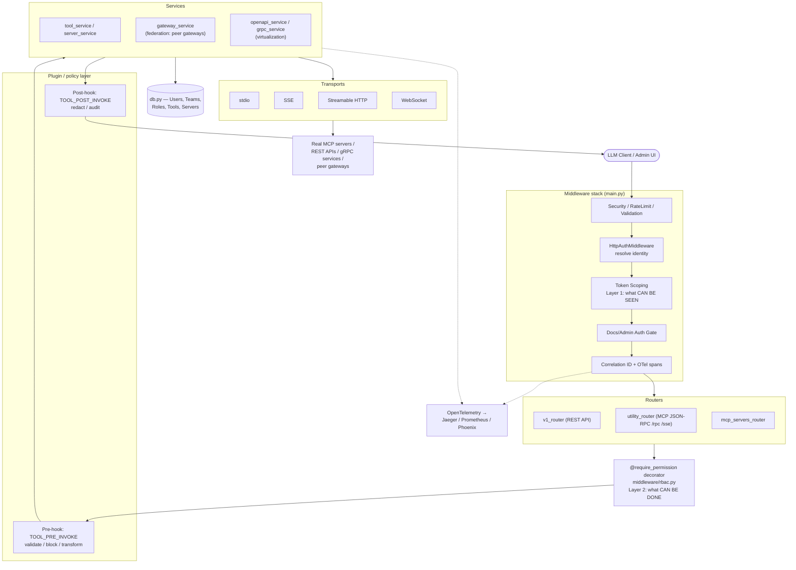

# MCP Gateway — Personal Doc
Source: IBM ContextForge (`mcp-context-forge/`), read 2026-09-16.

## 1. Core concepts

**MCP (Model Context Protocol)**: a client-server protocol for LLM apps to consume "primitives" — **tools** (callable functions), **resources** (readable data), **prompts** (templates) — from a server, over a transport (stdio, SSE, Streamable HTTP, WebSocket).  One server = one process/integration. Clients (Claude Desktop, agents) can normally only talk to one server at a time.

**What a "gateway" adds on top of raw MCP:**
- **Aggregation/federation** — register many MCP servers, REST APIs, gRPC services, A2A agents behind one endpoint.
- **Virtualization** — the *feature*: take a non-MCP API (REST endpoint, gRPC method) that has no concept of "tools" at all, and register it as a brand-new virtual MCP tool. Mechanism: parse the REST OpenAPI spec / gRPC reflection to generate an MCP tool schema that didn't exist before (`services/openapi_service.py`, `translate_grpc.py`).
- **Transport bridging** — a *different* thing: a **real MCP server** already exists and understands tools/resources/prompts, but only over one transport (e.g. local stdio). The gateway just swaps the pipe — same tools/schemas, reachable over stdio↔SSE↔Streamable HTTP instead (`translate.py`, `reverse_proxy.py` — the latter tunnels a local stdio MCP server out through a remote gateway via outbound WebSocket/SSE for NAT/firewall traversal, not REST virtualization).
- **Centralized governance** — auth, RBAC, rate limits, multi-tenancy, audit.
- **Discovery/catalog** — a directory of known public MCP servers (`mcp-catalog.yml`) that can be one-click registered.
- **Observability** — OpenTelemetry tracing/metrics (Phoenix, Jaeger, Zipkin, OTLP).
- **Plugin/policy layer** — hook points to inspect/transform/block calls (guardrails, PII filtering, audit).
- **Admin UI** — manage servers, tools, users, teams, roles, tokens.

ContextForge specifically = **Tools Gateway (MCP/REST/gRPC) + Agent Gateway (A2A, OpenAI/Anthropic agent routing) + API Gateway (rate limit/auth/retry/reverse proxy) + Plugin framework + Observability**, deployable via PyPI/Docker/Helm, Redis-backed for multi-cluster.

## 2. Architecture — request flow

`mcpgateway/main.py` builds one `FastAPI` app (~13k lines). Key pipeline (in order, from `app.add_middleware(...)` calls):

1. `SecurityHeadersMiddleware`, `HeaderSizeMiddleware`, `RateLimitMiddleware`, `ValidationMiddleware`
2. `MCPProtocolVersionMiddleware`
3. Token-scoping middleware (`token_scoping_middleware`) — via `MCPPathRewriteMiddleware` wrapper — **Layer 1** (visibility filtering)
4. `HttpAuthMiddleware` — resolves identity (JWT / proxy header / SSO / anonymous), runs plugin `HTTP_AUTH_RESOLVE_USER` hook
5. `DocsAuthMiddleware`, `AdminAuthMiddleware` — gate `/docs`, `/admin`
6. `ForwardedHostMiddleware`, `CorrelationIDMiddleware`, `TokenUsageMiddleware`, `ObservabilityMiddleware`, `OpenTelemetryRequestMiddleware`, `BaggageMiddleware`, `ClientDisconnectMiddleware`

Then routers are mounted (`app.include_router(...)`): `v1_router` (REST API), `legacy_router`, `utility_router` (MCP JSON-RPC `/rpc`, `/sse`, `/message`), `well_known_router`, `oauth_router`, `vault_router`, `mcp_servers_router`, `siem_router`, `llm_proxy_router`, etc.

Route-level authorization (**Layer 2**) is applied per-endpoint via `@require_permission(...)` decorators from `mcpgateway/middleware/rbac.py`.

**Directory map (`mcpgateway/`):**
| Path | Purpose |
|---|---|
| `main.py` | FastAPI app, middleware stack, router mounting, MCP transport bridges |
| `routers/` | REST endpoints per domain (auth, teams, tokens, rbac, catalog, mcp_servers, oauth, sso, siem, llm_proxy, reverse_proxy…) |
| `services/` | Business logic — one service per entity (`tool_service`, `server_service`, `gateway_service`, `permission_service`, `role_service`, `team_management_service`, `oauth_manager`, `sso_service`, `a2a_service`, `openapi_service`, `grpc_service`…) |
| `db.py` | SQLAlchemy ORM models (~70 classes) — see §3 |
| `transports/` | `stdio_transport.py`, `sse_transport.py`, `streamablehttp_transport.py`, `websocket_transport.py`, `rust_mcp_*_proxy.py` |
| `middleware/` | `rbac.py`, `auth_middleware.py`, `http_auth_middleware.py`, `csrf_middleware.py`, `rate_limit_middleware.py`, `token_scoping.py`, `security_headers.py`, … |
| `plugins/` | Plugin framework glue (manager, policy, hook dispatch) — actual plugins ship separately (see §5) |
| `alembic/` | DB migrations |
| `admin_ui/`, `templates/`, `static/` | Server-rendered Admin UI (HTMX-based, per `is_htmx` checks in auth code) |
| `translate.py`, `translate_grpc.py` | Transport bridging (stdio↔HTTP/SSE) and gRPC↔MCP virtualization entrypoints |
| `reverse_proxy.py` | Tunnels a local stdio MCP server (behind a firewall/NAT) out to a remote gateway via outbound WebSocket/SSE — transport bridging, not REST virtualization |

Federation (ADR-008): originally mDNS/DNS-SD auto-discovery of peer gateways — **deprecated**. Current model: explicit peer registration via `/gateways` REST API (`gateway_service.py`); `ToolService` handles remote tool invocation (OAuth, plugins, SSE supported). Tool name collisions across federated servers are resolved via `{gateway-slug}-{tool_name}` (ADR-011); IDs are UUIDs, not ints.

## 3. RBAC / auth model — the important part

ContextForge implements a **two-layer security model** (`docs/docs/manage/rbac.md`):

- **Layer 1 — Token Scoping**: what a token/user *can see* (data filtering by team/visibility)
- **Layer 2 — RBAC**: what a user *can do* (action permission check)
- Both must pass. Enforcement: middleware (Layer 1, request-level) + `@require_permission` decorators (Layer 2, per-route) + service-layer query filtering.

### Entities (`mcpgateway/db.py`)
- `EmailUser` — the user record (`is_admin` flag, password/SSO)
- `EmailTeam` / `EmailTeamMember` — teams; every user gets an auto-created **personal team**; resources are owned by a team
- `Role` — named permission set, has `scope` (`global` | `team` | `personal`), `inherits_from` (role inheritance), `permissions: list[str]`
- `UserRole` — join table: user × role × `scope_id` (team id or null for global) × `expires_at`
- `Permissions` (class in `db.py`) — the permission string catalog, dot-namespaced: `tools.read`, `tools.execute`, `servers.create`, `admin.system_config`, wildcard `*`, category wildcard `tools.*`
- `EmailApiToken` — DB-backed API tokens; carries its own `permissions` (JWT `scopes` claim) = Layer 1 grant, separate from the user's RBAC roles (Layer 2)
- `PermissionAuditLog` — audit trail of grant/deny decisions

### Built-in roles
`platform_admin` (global, `*`), `team_admin` (team, near-full), `developer` (team), `viewer` (team, read+execute), `platform_viewer` (global, read-only). New admins get `platform_admin`(global)+`team_admin`(personal team); new non-admins get `platform_viewer`(global)+`team_admin`(personal team).

### Resource visibility
Every resource (`Tool`, `Server`, `Prompt`, `Resource`, `Gateway`, `A2AAgent`) has `visibility ∈ {public, team, private}` + `owner_email` + `team_id`. `private` is **never** covered by admin bypass — strictly owner-scoped.

### Token → team resolution (`normalize_token_teams()`, `resolve_session_teams()` in auth code)
- **Session tokens** (browser login): teams resolved from DB per request (so revocation is instant); `is_admin` from DB → `None` (admin bypass) if admin, else DB team list.
- **API tokens**: JWT `teams` claim is sole authority. Missing key → `[]` (public-only, secure default). `null` + `is_admin:true` → admin bypass (`None`). `[]` explicit → public-only even for admins. `["t1"]` → team+public.
- Return semantics: `None`=skip all filtering; `[]`=public resources only; `["t1",...]`=team+public+own-private.

### Permission check (`mcpgateway/middleware/rbac.py`)
`@require_permission("tools.execute")` decorator flow, per route:
1. Extract `user` context from kwargs (must be a dict from `get_current_user_with_permissions`)
2. **Layer 1**: `token_scope_grants(token_scopes, permission)` — token's own JWT `scopes`/`permissions` claim must allow it (empty list = "inherit from RBAC", not deny-all)
3. Plugin hook `HTTP_AUTH_CHECK_PERMISSION` may override (only if `settings.plugins_can_override_rbac`)
4. Admin bypass check (`allow_admin_bypass` param — **admin routes set this `False`**, forcing explicit permission grants even for `is_admin=true` users — "delegated administration")
5. Team resolution: `team_id` derived from URL path param → resource's own `team_id` in DB → request payload → else `check_any_team=True` (aggregate across all the user's teams)
6. `PermissionService.check_permission()` collects user's roles (global+personal+team scoped), expands role inheritance, checks for `permission` or `*` or `category.*`
7. Grant or 403 (`"Access denied"`, deliberately generic — no permission-name leakage)

`require_permission(..., global_only=True)` skips team derivation entirely — used for routes managing team-less global resources (e.g. registered OAuth clients), where a team-scoped role must NOT satisfy the check.

Key file/anchors: `mcpgateway/middleware/rbac.py` — `token_scope_grants()` (L55), `require_permission()` (L921), `check_permission_inline()` (L727), `PermissionChecker` (L1233). `mcpgateway/services/permission_service.py` — actual DB-backed role aggregation.

## 4. Plugin framework

Purpose: pre/post hooks around lifecycle events for validation, transformation, policy enforcement, audit — **not** just tool-call guardrails. Two hook families (`docs/docs/architecture/plugins/`):
- **Security/tool hooks**: around tool/resource/prompt invocation (`TOOL_PRE_INVOKE`, `TOOL_POST_INVOKE`, etc.)
- **Gateway admin hooks**: `server_pre_register`/`post_register`, `server_pre_update`/`post_update`, `server_pre_delete`, `server_pre/post_status_change`, and equivalents for federated `gateway_*` (peer gateway registration). Each pre-hook can validate/transform/deny before the DB write; post-hook fires after, for audit/notification/cache-invalidation.
- HTTP-level hooks: `HTTP_AUTH_RESOLVE_USER` (custom auth), `HTTP_AUTH_CHECK_PERMISSION` (can override RBAC decisions if `plugins_can_override_rbac=True`).

Architecture direction (ADR-039): moving from a monolithic in-process plugin to **fully independent Rust crates**, each plugin its own crate, exposed to Python via PyO3 bindings (in-process) or gRPC/HTTP (out-of-process). Glue lives in `mcpgateway/plugins/` (`gateway_plugin_manager.py`, `policy.py`); actual plugin implementations live outside this repo layer (40+ plugins claimed in README).

## 5. Tech stack & deployment

- **Web**: FastAPI ≥0.140, fully async
- **ORM/DB**: SQLAlchemy ≥2.0, Alembic migrations; SQLite by default (`sqlite:///./mcp.db`), Postgres supported
- **Validation**: Pydantic v2 + pydantic-settings
- **Observability**: OpenTelemetry + `prometheus-fastapi-instrumentator`
- **Caching/federation**: Redis (event store, session affinity, multi-cluster)
- **Rust**: `crates/mcp_runtime` — optional sidecar (`RUST_MCP_MODE=off|shadow|edge|full`) moving the hot-path MCP transport (session/event/resume/streaming) out of Python for perf, while Python stays authoritative for auth/RBAC/token-scoping. **Deprecated as of 2026-06-11**, sunsetting 2026-07-07 — new deployments should skip it and use the Python transport. Built on `axum` + `rmcp` + `tokio`.
- **Deployment**: Docker/Compose (many compose variants: TLS, SSO, SIEM/OpenSearch, Langfuse, Phoenix), Helm chart (`charts/`), Ansible playbooks (`ansible/`), PyPI package `mcp-contextforge-gateway`, Fly.io config present.
- **Catalog**: `mcp-catalog.yml` — curated list of public MCP servers (Asana, GitHub, etc.) with pre-seeded OAuth discovery metadata, for one-click Admin-UI registration (never contains client secrets).

## 6. If rebuilding from scratch — minimal component checklist

1. **MCP client/server core** — implement the base protocol (JSON-RPC, tools/resources/prompts schema, capability negotiation) for at least one transport (start with Streamable HTTP or stdio).
2. **Tool/server registry (DB)** — entities for `Server`, `Tool`, `Resource`, `Prompt`, `Gateway` (peer), with UUID ids and a name-collision strategy (namespace by owning server, per ADR-011).
3. **Transport bridge / virtualization layer** — stdio↔HTTP adapters; REST→MCP tool adapter (JSON-schema extraction from OpenAPI).
4. **AuthN** — pluggable identity (local email/password + JWT, then SSO/OAuth). Decide session-token vs API-token semantics early — they behave differently (DB-resolved vs claim-resolved teams, per §3).
5. **Multi-tenancy model** — teams as the ownership unit, `visibility` enum (public/team/private) on every resource, personal-team-per-user.
6. **RBAC (Layer 2)** — `Role`/`UserRole`/`Permissions` tables, `resource.action` permission strings, role inheritance, a single `check_permission()` service function, decorator to guard routes. Decide bypass semantics for admins explicitly (don't let `is_admin` silently bypass everything — see "delegated administration" pattern).
7. **Token scoping (Layer 1)** — separate, narrower grant embedded in the token itself, independent of RBAC roles; document the "empty scope = inherit from RBAC, not deny-all" trap explicitly (easy bug to introduce).
8. **Federation** — peer gateway registration API + remote tool proxying; skip auto-discovery (mDNS) unless you truly need zero-config — ContextForge deprecated it.
9. **Plugin/hook framework** — define hook points (pre/post around every mutating admin action + tool invocation) before you have many use cases, or retrofitting is painful.
10. **Admin UI** — thin server-rendered layer over the same REST API, gated by the same RBAC.
11. **Observability** — OpenTelemetry tracing from day one (request_id/correlation_id propagation is load-bearing for both auth debugging and tracing).
12. **Catalog** (optional/last) — curated list of known third-party MCP servers for discoverability.

## 7. Notable / surprising things

- **Two-layer security (token scope + RBAC) is the crux of the RBAC design** — most bugs/edge-cases in the docs are about the interaction between these two layers, not either one alone. This is the single most valuable idea to study for the "RBAC" part of your project name.
- Admin (`is_admin=true`) does **not** imply full access by default on admin routes — `allow_admin_bypass=False` is used deliberately to support "delegated administration" (grant only specific `admin.*` permissions).
- `private` visibility resources are excluded from admin bypass entirely, even for global admins — a deliberate hardening (PR #4341).
- mDNS/DNS-SD zero-config federation was tried and **removed** — a useful negative data point if you were about to add "auto-discovery" to your own gateway.
- The project is mid-migration from a pure-Python hot path to an optional Rust sidecar for MCP transport — but that migration itself is now being deprecated/reverted, suggesting the added ops complexity wasn't worth the perf win for most deployments.
- Scope: this is a *huge*, heavily productionized codebase (SSO, SIEM export, vault integration, gRPC-to-MCP, A2A agent routing, LLM proxy, compliance router...). Don't try to replicate all of it — the checklist in §6 is the essential 20%.

## 8. Minimal checklist — "many MCP servers behind one endpoint" only

Narrower than §6: no multi-tenancy, no RBAC, no plugin framework, no peer federation. Just: one endpoint, N backend MCP servers, correct routing.

1. **MCP protocol core** — JSON-RPC handling, tools/resources/prompts schema, capability negotiation, for one transport (Streamable HTTP or stdio).
2. **Server registry** — a list/table of registered backend servers (name, transport, connection info). Doesn't need to be a full DB — a config file or simple table is enough at single-user scale.
3. **Tool aggregation + name-collision strategy** — on startup/registration, fetch each backend's `tools/list`, merge into one catalog exposed at the single endpoint. Namespace by owning server (e.g. `{server}-{tool}`) so two backends can't clash (ADR-011's approach, minus the federation part).
4. **Call routing** — incoming `tools/call` → look up owning server from the aggregated catalog → forward → pass response back through. This is the actual "gateway" behavior.
5. **AuthN, minimal** — single API key/bearer token guarding the one endpoint. No session-vs-API-token distinction, no SSO.
6. **Backend connection handling** — keep persistent connections (or reconnect-on-demand) to each backend transport; surface backend-down errors distinctly from tool-not-found errors.

Explicitly out of scope for this goal (see §6/§7 if you outgrow it later): multi-tenancy/teams, RBAC (§3), token scoping layer, peer-gateway federation, plugin/hook framework, Admin UI, observability, catalog.
